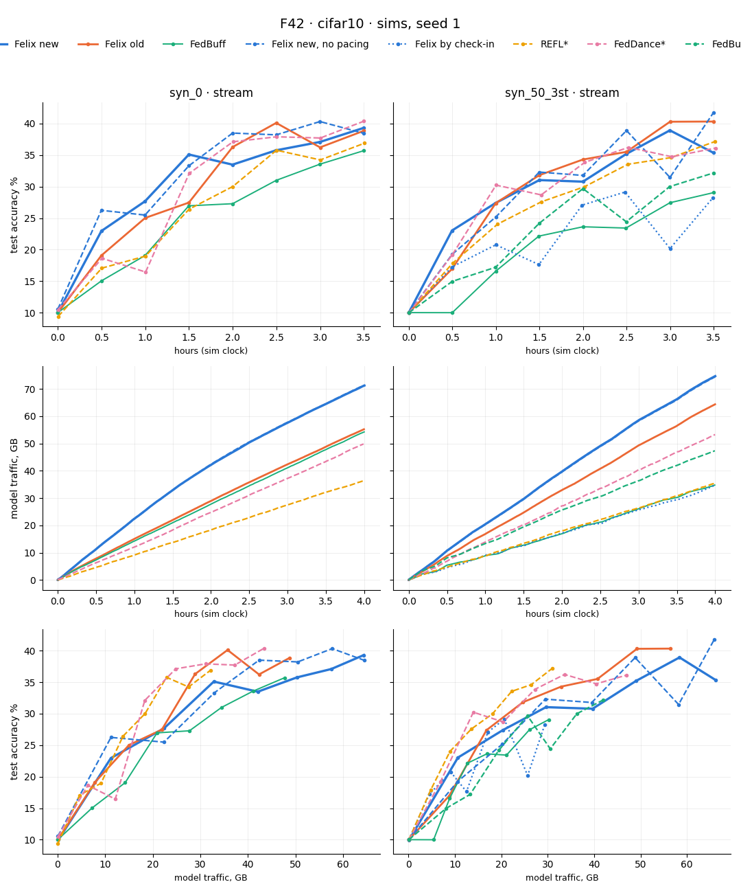
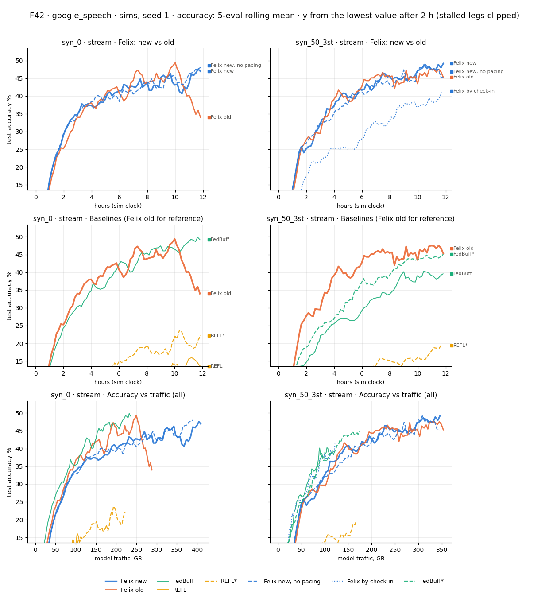
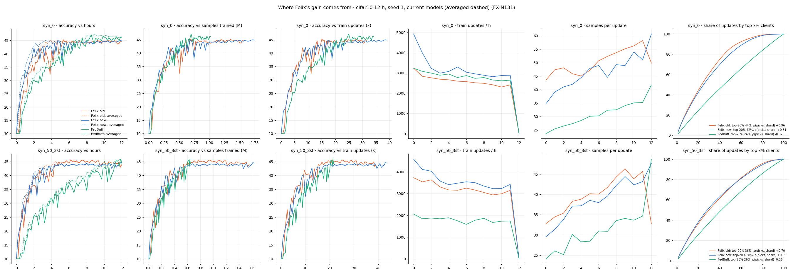
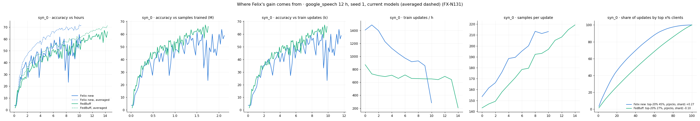

# Felix readiness — backprop FL (async_cifar10, google_speech)

Read [ROBUST_FL_READINESS.md](ROBUST_FL_READINESS.md) and [PARITY_READINESS.md](PARITY_READINESS.md) first; their rules, L and T apply
here unrepeated. **Focus (operator 10-22): Felix v2 on a fast bench (Active build "Felix v2"), then the harness; then the claims gate (FX-N108)
and sim-only experiments (FX-N12).** Order: Next steps → Scoreboard → Decisions → reference sections. Rejected ideas, one table: Active build "Common ideas we tested and rejected".

**Setup reset (operator 10-21): only runs from F41 (10-21) onward count** (trace-tied `usage` streams, FedScale task time, R27
availability knowledge). Earlier results ran on static data or an older runtime and are not evidence (`git log` keeps them).

**At a glance (10-23, 05:40): next = parse F43 (FX-N139).** cifar now scored averaged vs averaged for every arm (F42g). Felix new is first in time to 40% in both cells
and lowest in GB on syn_0 only. Felix plateaus at 43-45% by hour 4 while FedBuff / REFL* / FedDance pass it by 8-10 h; normalized sub-batch steps buy ≤ 1 pp on
same code (FX-T79), and no inferred phase switch exists (FX-N134 dropped). Bytes: 3 local epochs cut GB to 40% by 40-48%
(lowest of all stacks by ~2×) at +4 / +17 min (FX-N135). The F42-T12 fixes
brought check-in FedDance / FedAvg to their oracle's AUC and REFL syn_50_3st from 27 to 34. Per-update value can't steer selection
(FX-T78). Speech F42g (stage B) is running on shepherd.

**Terms (operator 10-23).** Each aggregation makes a new global model version. *Current model* = the latest version. Training always
continues from it, and baselines are scored on it. *Averaged model* = a running average of recent versions (EMA, β = 1 − K/n ≈ one pass over
all clients). It is only evaluated or handed out, never trained from, and costs no bytes. It cancels each version's pull toward the last K
non-IID clients. Code labels: arm `X_srv` = averaged, `X_srv:raw` = the same leg's current model (rename: FX-N133).

## Next steps (persistent queue — top item is next)

Work rule: PARITY C10, C17, C18; ROBUST R0. Test levels: pytest (~1 min scoped) · CPU tiers (F42C sim / F42CR real, stub) · GPU
smokes ≤ 15 min (F42 `--scale-smoke 3600`, F42R real) · screens (F42 sims: a 4 h-vclock leg takes 4-12 min wall) · long (G3 reals).

**Run naming (operator 10-21): the batch number changes only at a long-run launch; screens stay F42 with a letter (F42a, F42b).**
Every batch runs Felix new and old side by side; FedDance and Oort run only after the Felix decision or when their code changes.

- **FX-N139 · RESUME HERE: parse F43 before any further Felix fix or optimization, both datasets (operator 10-23) · launched by
  the operator.** *Goal (operator 10-23):* targets up to the 70% goal, so the populations rise to the reference cohort (ceilings,
  `experiments/ceiling_1022` b64: cifar n 300 69% at 48 h, 72% at 72 h; speech n 100 72% at 12 h, 73-79% at 24 h; n 75 / 50 cap at 61% /
  74% by day 6). Every F43 leg stops once the mean of its last 5 evals ≥ 70% (`targetWindow`, FX-D229; operator 10-23).
  *Batch (two commands, ~8.5 h jayne / ~6 h shepherd GPUs 4-7):*
  - jayne tmux: `cd ~/flame && git pull && bash lib/python/examples/scripts/run_f43_jayne.sh` → `experiments/F43_jayne_<ts>/`.
  - shepherd tmux (worktree; stage B keeps the main tree and GPUs 0-3): `cd ~/flame_f43 && git pull && bash
    lib/python/examples/scripts/run_f43_shepherd.sh` → `experiments/F43_shepherd_<ts>/`; copy it and its `run_*gs_F43_*` dirs to jayne.
  - cifar (jayne, bench): n 300 c 60 K 15 (sync K/N 5%, L34), 120 h vclock (trace end) from day 1, both cells, seed 1, all six + `*` +
    Felix old, l3b, l3b_e2, l3b_e3 (26 legs at once on GPUs 0,5,6; `FLAME_TELEMETRY_LEAN=1`; 8.3 h timeout). Measured
    (`bench_F43_smoke_1023_0457`, 2 h vclock): Felix l3b / old 12 min (slowest: cut near ~80 h unless they stop at 70%), e3 6.6 min,
    FedBuff 5, REFL 5.7, Oort 0.7; ~6 GB RAM, 3.5 GB GPU, SM 9-26% per leg (CPU-bound); full telemetry 99% `selection.per_trainer`.
  - speech (harness), n 100 c 30 K 10, 24 h, syn_0, one leg per node at a time: jayne GPUs 2-4 Felix l3b_e3 then l3b; shepherd GPUs 4-7
    FedBuff (ctl), then FedBuff* if FedBuff ends within 3 h. Measured (`pool_F43_spsmoke` on shepherd): 6.3× real time (24 h ≈ 3.8 h),
    leg RAM 119 GB, GPU peak 36 / 45 GB, 0 overruns. Felix old and syn_50_3st speech: next batch.
  *Prediction:* cifar: no stack reaches 70% at n 300 by 72 h (FL ~2-4 pp under the 72% ceiling); 60 / 65% reached; l3b_e3 lowest GB to every
  target it hits, Felix first in time at 40-60%; the e3 plateau ≤ l3b's. Speech: Felix reaches 60-65% in 24 h; 70% only if FL tracks the
  ceiling within 3 pp. *Parse (in order):* (1) `cifar_report.md` / `speech_report.md` (bench_report: AUC, time + GB to 40-70%, final,
  ceiling); (2) EV summary on the speech pool, `config_audit.py`; (3) rewrite the Scoreboard (new F43 table) and `felix_plots.py` with
  the ceiling; (4) record which targets each stack reaches and where Felix loses (time or bytes), and re-rank FX-N135 / N136 on that.
  *Then* resume FX-N135. Cut legs (timeout before 120 h) still score every target they reached; a stopped leg's "final" is its stop point.
- **Storage (operator 10-23):** jayne `/home` 1.4 TB free (`cleanup_experiments.py` dry run would free 238 GB: uncited run dirs, `.pt`);
  shepherd 289 GB free of a shared 2.6 TB (ours 254 GB: `flame` 182, `aish_test` 53; cleanup frees 9.7 GB). Prune with `--apply` on the
  operator's word (R21); lean telemetry on every n ≥ 300 bench leg.
- **FX-N135 · Bytes via local work · wip (after FX-N139's parse).** Felix config = l3b + prefix one batch (FX-N134 dropped).
  GB to target = updates to target: lost dispatches < 1%, ~4.3 MB / update (l3b syn_50_3st: 43454 sent, 43420 committed), so skipping
  sub-batch tasks frees slots, not bytes. Lever = accuracy per update via local epochs (FX-L99). *Screen F42h-ep (10-23, bench,
  3 seeds, 12 h, `experiments/bench_F42h_ep_1023_0441` vs same-code l3b in `bench_F42h_drift_1023_0418`):* min / GB to 40% · final %

  | arm | syn_0 | syn_50_3st |
  |---|---|---|
  | l3b (1 epoch) | 100 / 33.0 · 44.6 | 120 / 37.4 · 43.5 |
  | l3b_e2 | 100 / 22.0 (−33%) · 43.9 | 130 / 27.8 (−26%) · 43.2 |
  | l3b_e3 | 104 / 17.3 (−48%) · 43.9 | 137 / 22.6 (−40%) · 42.8 |

  Prediction held (GB −20-40%, ≤ +30 min, final ≥ l3b − 1 pp). e3 beats every baseline's GB to 40% (best: REFL 36.1, REFL* 36.0) by
  ~2× and stays first in time on syn_0 (FedDance* 180, REFL* 237 min); syn_50_3st 137 vs Felix old 134. *Next, in order:*
  1. Sweep e4 / e6 (bench, 12 legs, ~15 min, jayne + shepherd allowed): where do GB and time to 40% / final turn?
  2. Make it constant-free: epochs from the client's own modeled times (compute = k × transfer, FX-D201 `split` without its one-epoch
     cap), or from visible samples (steps ≥ a floor); screen against the best fixed E. Rejected shortcuts: none yet.
  3. Higher targets: time / GB to 43 / 45% on a 24 h bench leg (shepherd) for l3b vs the winner (local work may cap the plateau: Oort's
     20 steps never reach 40%).
  4. Speech (FX-N136 4): the winner on the harness (shepherd, after F42g is scored); speech comm 205 s vs compute 73 s per task, so
     extra epochs are cheap in time there.
  Then decide the Felix-new config and refresh Scoreboard + plots.
- **FX-N136 · Speech: Felix pitfalls · wip.** (1) ✅ Sanity: speech streams by cifar's `usage` rule (EV19 0 off-schedule of 17k tasks,
  visible 1/6 → 1/4 over 12 h, both cells). (2) Sub-batch share: speech 0% (median 160-190 samples / task vs batch 16; cifar 37%), so the
  sub-batch hypothesis is refuted for speech. Left: per-eval swing of the current model (model vs eval noise). (3) Hypotheses left:
  c = 30% of n leaves C3 little to reorder; bf16. (4) Speech Felix screens on the harness (shepherd, > 20 min): l3b (decided config) once F42g is scored.
- **FX-N137 · Buffer composition / attention · todo, low priority.** Headroom is real (`value_headroom.py`: greedy buffer oracle +0.10-0.18
  nats per version over random) but single proxies fail (FX-T78). Next: combine signals as *weights*, not discards (a discard wastes the
  bytes already spent): weight ∝ coherence with the leave-one-out buffer mean × sample share × staleness, scored in `value_headroom.py`
  against the oracle before any code. Prior: V4 found consensus cosine ≈ 0 for oracle weights, so expect little.
- **FX-N138 · Remove Felix-new constants · todo.** Prefix 64 → one batch (`utilityPrefixSamples=-1`; ties l3b). Rate `new`'s
  scale 0.4, a 0.25, b 0.1: derive a from the staleness distribution. γ 1.0 stays.
- **F42g speech baselines · running on its own (operator 10-23: let it run as is; shepherd tmux `dg_f42g`, pool
  `experiments/pool_1023_F42G_SPEECH_SHEPHERD`, launched 02:41).** Every speech sync baseline + FedBuff*, averaged, 1 seed, no Felix legs
  (a Felix config change does not void it). 04:32: 5 / 18 done; one leg at a time (rest `BLOCKED: no GPU room`), legs ~21 min, the
  pool's 14:44 deadline skips later starts. Shepherd's tree = bb59959ed + `/tmp/dg_wt_1023.patch`. *Next, in order, once `pool.log`
  shows the last DONE (or the deadline passed):*
  1. Copy the pool + its `async_cifar10/experiments/run_*gs_F42_*` dirs to jayne.
  2. Score: `bench_report.py` (avg / cur), `config_audit.py`, EV summary; check F42-T12's speech exits (sync check-in ≥ 80% of `*` AUC,
     round gap ≤ 1.2×). List the legs SKIPPED by the deadline.
  3. Reset shepherd: `git checkout -- . && git pull` (no pool running).
  4. Rerun on shepherd, current code: both fbstar legs (DOOMED EV22 by the pool's in-memory pre-`_srv` checker; the current one
     classifies them oracle) + every SKIPPED leg (`harness_pool --tier F42 --datasets google_speech --phases '<those>'`, ~21 min each).
  5. Rewrite the Scoreboard speech table on the averaged basis and `felix_google_speech.png`.
  Orphans: `pool_20261022_2018_F42C_SHEPHERD_S{0,1}` (pids 2227002 / 2227142), operator stops them.
- **FX-N133 · Fair averaged-model scoring · wip: code done, F42g scores it.** Built: sync stacks average too (FX-D219); labels `avg` / `cur`
  in `bench_report.py`; `felix_plots.py --basis avg|cur` puts every series on one basis (default stays mixed). *Exit:* F42g above.
- **F42-T12 · Baseline reds · wip: fixes in, F42g confirms.** (a) closed: FedBuff EV23 passes on current code (F42f bench syn_0 3 / 3; the
  F42b fail predates T9). (b)/(f) closed: EV16 was a checker false positive. A delivery due at the same instant a version closes joins the
  next version (FX-D220); FedAvg / FedDance / Oort then drop it as stale (FX-N57), REFL commits it. All 4 DOOMED speech syn_50_3st legs (REFL, FedAvg, FedDance, Oort)
  re-grade PASS. (c) REFL picks follow the fork's priority-fill (FX-D221): smoke `bench_T12b_smoke_1023_0152` syn_50_3st AUC 27.1 → 33.9,
  final 29.6 → 39.9%, top-20% share 0.66 → 0.33 (REFL* 0.24). (d) Sync check-in on syn_0: an early arrival to a late round is bounced a
  whole phase, and the sim drained stale stragglers past the next check-in (FX-D222). Smoke `bench_T12_smoke_1023_0139`: FedDance AUC
  34.3 → 37.7, 40% at 364 → 250 min, round gap 2.2× → 1.4× of FedDance*; FedAvg 33.2 → 36.8. (e) closed (`_r2` rows audit). (g) the
  "UN_AVL share at selection" is believed state, not offline picks (relabelled). *Exit left:* F42g EV PASS on every leg; speech syn_0
  sync check-in ≥ 80% of its `*` AUC; round gap ≤ 1.2× of `*` or a cited reason (polling at window granularity is the protocol's floor).
- **FX-N132 · Optimize Felix new, general mechanisms only (operator 10-22) · wip; FB1 deferred (operator 10-23).** Goal: Felix first in
  time AND bytes to target in every cell, scored averaged vs averaged. Findings so far (`felix_why.py`, all seeds; `felix_why_<ds>.png`):
  - *Cifar:* new turns slots over faster early (hour 1: 4.9k vs 3.2k updates, 44 vs 50 samples / update), equal per sample and per update.
    Both Felix arms plateau at ~44% by hour 4. They spend another 100-120 GB for 0 pp, and FedBuff passes them at 8 h (45.5-45.8 vs
    43.5-44.5% at 12 h). Felix's picks are concentrated (top-20% share 42-44% vs FedBuff 24%).
  - *Speech:* new runs +3-28% more hour-1 updates and 30-60% more all day on syn_0, at equal accuracy per update and lower per sample than
    FedBuff. Extra turnover becomes bytes, not accuracy: the current model swings ±10-20 pp between evals, so more noisy steps don't help.
    New de-prioritizes big shards (ρ(picks, shard) +0.27 vs old +0.76). Speech has not plateaued at 12 h.
  - *Per-update value (d), `scripts/value_headroom.py` (R26 model, cifar, 2 seeds × versions 20 / 100 / 400):* the greedy buffer oracle
    beats random by 0.10-0.18 nats per version. Picking by individual update value or pre-step loss q is worse than random (FX-T78). |D|,
    |D| q, delta-cosine diversity and label balance (classifier-bias deltas) ≈ random. Value persists weakly (ρ 0.53 → 0.15). The
    headroom is in buffer composition, and no cheap proxy captures it.
  - *Plateau root found (F42g screens, cifar, 3 seeds, averaged; table in Scoreboard).* Not concentration (γ 3 ❌), not the rate
    (FedBuff's rate on l3b ❌), not selection (uniform picks inside Felix: final 43.4 / 41.5, worse). It is the step on sub-batch
    updates. On `usage` streams many tasks train on fewer samples than one batch (Felix new 37%, FedBuff 61% of tasks), and Felix
    steps them at full lr. FedBuff's §5 last-batch lr normalization (`lr_batch_normalize`) scales that step by samples / batch:
    uniform + FedBuff rate → + normalization lifts final 43.0 → 45.1 (syn_0) and 40.6 → 44.5 (syn_50_3st). On l3b (`l3bn_srv`) it is a
    trade-off: AUC equal, final +0.4 / +1.3 pp, but 40% +30 / +40 min and +40% GB. Prefix = one batch (`l3b_pb_srv`) ties l3b → adopt at
    the next batch (`_PRE` → `utilityPrefixSamples=-1`, config_audit `_L3` prefix "-1"; not switched mid-batch).
  Open (operator 10-23): **decide the Felix-new config on cifar first, then run speech Felix legs once.** Time to accuracy first, at
  the real targets (not only 40%); bytes second, cut as far as a general mechanism allows. Constants may be removed as needed.
  *Constant audit (10-23):* Felix-new mechanisms carry no per-dataset / model / n / K / c tuning: C3 is a ratio (|D| q / task s), serve-EMA
  derives β = 1 − K/n, the pacer's τ is the operator's one system setting. Fixed but dataset-free: rate `new` (scale 0.4, a 0.25, b 0.1),
  prefix 64 samples (→ one batch), balance γ 1.0, pacer c_min 2. Setup values shared with FedBuff, not Felix choices: K 10, c 15 (20% of n cifar, 30% speech), client lr 0.04, batch
  32 / 16, server lr 1.0.
- **FX-N129 · Bench gate (V5) · wip.** Cifar B2 27 / 27 (Scoreboard). Speech: the bench is GPU-compute-bound (~1 GPU-h per 12 h Felix leg,
  workers don't help), so speech screens run on the harness; speech B2 only if speech moves to the bench. Left: B3 (`predictor_audit.py`).
- **FX-N127 · Pacer v2 · parked (FX-T75).** Built (FX-D215, FX-D216), screened: loses AUC. *Next try:* n 300 (4× reports), or a
  cut rule that needs an equivalence test (gain provably below a share of its peak) instead of z < 0.5; decide with the operator
  whether hours-scale cuts are acceptable (Decisions "Pacer design" says minutes).
- **FX-N128 · Aggregation (V4) · wip.** Replay (`experiments/v4*_replay_1022`): per-update weights fail (FX-T77); the oracle's headroom is
  mostly step size, but a smaller fixed step loses closed-loop (FX-T76); serve-EMA (FX-D217) is the kept lever. *Next:* an early-big /
  late-small server-step schedule driven by data, if one can be made constant-free.
- **FX-N131 · FB1: bench batch, day 0 → 6, n 300 / 100 (V6) · deferred (operator 10-23).** Arms: Felix old (ctl_srv), Felix v2 (l3b_srv;
  pacer only if N127 revives), FedBuff (ctl_srv, raw = the baseline), FedBuff*, REFL, REFL*, FedDance, FedDance*,
  FedAvg, Oort, Oort*; syn_0, syn_50_3st, mobiperf_3st; seeds 1-3. *Question:* does Felix v2 track the ceiling at lower bytes than
  every baseline? *Prediction (C19):* v2 ≤ every baseline in time to 90% of the ceiling on every cell; bytes over 6 days −40% vs Felix
  old at ≤ 1 pp AUC; v2 resumes within 10 min of each data burst. *Stop rule:* v2 within Felix old's seed band on time and bytes →
  drop the feature that does not pay, keep the rest. *Read:* accuracy_table, felix_plots (+ ceiling), pacing_plot, bytes / h plots.
  Then decide the harness phase (F43 / D5) on the winners.
- **F42-T11 · REFL real startup · todo.** REFL real trainers import and fit Prophet before their first check-in: F42R REFL reached 399
  of 480 s (EV12 FAIL; ~80 s lost, ~1% of a 2 h leg) and its leg RAM is 116 vs 95 GB est (RAM_OVER). *Exit:* EV12 PASS on an 8-min
  F42R REFL leg and leg RAM within estimate (lazy fit after the first check-in, or a raised RAM estimate).
- **F42e · Silent drops and packet loss (ablation) · todo.** A client that vanishes silently holds its slot until `send_timeout_wait_s`
  (Felix cifar 677 s / speech 1920 s); no heartbeat or per-client timeout. Inject p ∈ {1, 5, 10}% silent losses and notify delay / loss;
  candidate fix: per-client timeout = k × its modeled task time. *Exit:* Felix within 1 pp AUC of p = 0 at 5%.
- **D5 · Long runs (next batch number) after F43 · todo.** Parity re-graded on the streaming setup with R27 knowledge (G3 reals +
  sims, both cells, all six): the pre-reset parity reds (old FX-N9, N103, N110, N113) are re-checked there, not chased on old keys;
  claims (FX-N108) on long sims. Re-measure real notify latency (F42R: 15 flips) and check-in throughput on 2 h reals.
- **FX-N108 · Felix claims gate (operator 10-17) · blocked: D5; blocks FX-N12.** `felix_claims.py --felix-arm` grades one Felix arm per
  cell on long sims with the 10-min eval cadence. C4 heterogeneity: out of scope while every run is α 0.1 (operator 10-19).
- **FX-N100 · Throughput (central goal, operator 10-15) · wip.** Bench (V5): 72 cifar 12 h legs in 32 min on jayne alone (121-141
  legs / h; 4 legs × 3 processes per GPU, 1 math thread each; Felix legs 10-12 min). F42b: 50 sims of 12 h vclock in 3.3 h on both nodes (plan 5.5-6 h),
  legs 8-41 min wall (18-95× real); host RAM binds (84-99 GB per leg); cifar Felix telemetry 1.9 GB per leg (~100 MB/min, PL8's ceiling). *Next:* FX-N84's fork-server import sharing (~280 MB / trainer).
  *Exit:* a 10-min mixed batch at ≥ 2× PR36's legs / h with interference at the solo baseline.
- **FX-N94 · tiny_cpu first-contact sim delivery lag · todo.** `smoke_fxd160_0010`: first-contact lag 1.1-1.7 s (real ~0.03 s), sim
  clock +1.7 s by round 3; GPU legs ≤ 0.5 s. *Exit:* first-contact lag ≈ later tasks' on tiny_cpu.
- **FX-N85 · Close PR27/PR28 roots · wip.** (b) cifar Oort-family stub legs run one real step (FX-D110 extended); (c) A5 builder:
  apply FX-D125's observed-window rule to `state_timeline_agreement`. *Exit:* every listed cell green or floor-gated.
- **FX-N92 · Felix insights for the paper (operator 10-12) · wip.** [FELIX_INSIGHTS.md](FELIX_INSIGHTS.md) Next steps IN1, IN2, IN4.
  *Exit:* findings for every catalog row, real↔sim agreed.
- **FX-N90 · FedDance coverage under over-commit · todo.** Literal Alg. 1 l.3 zeroes picked-but-never-aggregated devices forever (F3
  syn_0: 104/300); `straggler_score: mean` restores coverage but biases to slow ends. *Exit:* a cited rule with coverage ≈ random and
  no speed bias, or recorded as FedDance's own.
- **FX-N91 · EuroSys plot debts (no runs now, operator 10-12) · todo.** (a) controls: G1X cifar syn_0 `fedavg` sim 20 h; G1X speech
  mobiperf `felix`; (b) a `straggler_score: mean` arm (FX-N90); (c) REFL label + ×1.06 factor; (d) MobiPerf e2e table vs logs (OORT* 15.6
  vs 9.45 h; REFL mobiperf has no log); (e) speech e2e May-2025 rows have no logs; (f) comm to 70% from counted messages, not time share.
- **FX-N84 · Trainer memory audit · wip.** PSS/trainer cifar 1052 MB, speech 1160 MB after lazy mlflow + own coords; aggregator
  `malloc_trim` after eval. Left: `import torch` ~280 MB, cuDNN/cuBLAS host ~390 MB (fork-server sharing: FX-N100). *Exit:* footprint
  table, fixes, new caps.
- **FX-N76 `[C][S]` · C13 real-cost audit · wip.** Real speech FedBuff arrival → commit 0.12 s mean (sim 0): profile and charge it if it
  moves K2. Re-measure in D5.
- **FX-N42 `[S]` · Parity ladder · wip (PARITY Q2-Q6).** *Exit:* a run graded per cell on both axes, DIST on ≥ 3-leg floors.
- **FX-N10 · google_speech on the launcher · wip.** *Next:* S4 cleanup.
- **FX-N22 · Fast parallel harness · wip.** ISO oort,oort_star solo vs packed at cpt 0.5 / 0.25 (`harness_iso_compare.py`).
- **FX-N2 · Parent S2 pipeline for async_cifar10 · todo.**
- **FX-N93 · Convergence parity at the reference config · todo (after D5).** One C19 block per step: (1) six × both datasets reach
  target or are audited round-bound; (2) real↔sim pairs + real replicate at reference n, deterministic kernels; (3) syn_50_3st +
  mobiperf_3st; (4) sim speed ≥ 5× at reference n (S6); (5) FX-N12. Graded on the convergence board.
  **FX-N12 · paper experiments sim-only · blocked: D5, FX-N108.**

**F42 reference: arms, knobs and built pieces.**

  **F42 knob table (Q-F42-KNOBS: operator to confirm).** All legs: n 75 cifar / 50 speech, α 0.1, K 10, trace-tied `usage` stream from
  24 h, `validation_holdout` 0.1 on arms reading it, else 0 (FX-D212), FedScale task time, per-baseline timeout (FX-D198), seed 1.

  | leg (arm) | availability knowledge (R27) | selection | aggregation | K / c | probes · pacing | other |
  |---|---|---|---|---|---|---|
  | Felix old (ctl) | notify: filter + evict at flip | Oort score, size-driven, UCB; eval tasks (factor 1, 35-version gate) | FedBuff, rate `new` | 10 / 15 | – | 1 epoch |
  | Felix e0 | notify | as old, eval off | rate `new` | 10 / 15 | – | update stats |
  | l3 = e0 + C3 | notify | \|D\| q / last task s (prefix-64 loss) | rate `new` | 10 / 15 | – | |
  | l3b = l3 + balance | notify | × (1 + picks / mean)^-1 | rate `new` | 10 / 15 | – | |
  | l4 = l3b + C4 | notify | as l3b | rate `new` | AIMD K (floor 5, memory, stall) / 15 | – | |
  | l5 = l4 + C5 (Felix new, no pacing) | notify | as l3b | value × staleness | AIMD K / 15 | – | |
  | **l5p = l5 + pacing (Felix new)** | notify | as l3b | value × staleness | AIMD K / pace_c (≥ c/4) | 60 probes / h, AVL_EVAL first; window 1 h, ≥ 150 samples | |
  | e0p = e0 + pacing | notify | as e0 | rate `new` | 10 / pace_c | as l5p | isolates pacing |
  | Felix + check-in (fck, K1) | check-in (no notify, no eviction) | as l5p | as l5p | as l5p | as l5p | isolates notify |
  | FedBuff | check-in (async: pooled while a slot is free) | uniform async | FedBuff 1/√(1+τ) | 10 / 15 | – | as published |
  | FedBuff* (fbstar) | oracle: trace online set at selection | uniform async | as FedBuff | 10 / 15 | – | labelled oracle |
  | FedAvg (ablation) | check-in (sync windows) | uniform | FedAvg equal | 10 / 13 | – | FedDance's training config (1 step) |
  | REFL | check-in + on-device Prophet p(avail in [μ, 2μ]) sent with it | Alg. 1: least available first (hold-off 0, deviation) | SAA | 10 / 13 | – | 1 step |
  | REFL* (rstar) | oracle: filter + future trace (fork's simulation, 10% knockout), no hold-off | IPS priority | SAA | 10 / 13 | – | labelled oracle |
  | FedDance | check-in; V_m (Poisson) counts its per-round check-ins | V·I·A + MAB | FedAvg equal | 10 / 13 | – | |
  | FedDance* (fdstar) | oracle: filter + V fed by the trace online set | V·I·A + MAB | FedAvg equal | 10 / 13 | – | labelled oracle |
  | Oort / Oort* | check-in / oracle | – | – | – | – | not in F42 (cadence) |
  Check-in (all non-`*` baselines): sync window W = 10% of the round estimate (EWMA α 0.25, prior = task timeout), rejected →
  reconnect in the next window + U(0, W) (overdue: now + μ); async reconnect = now + m × gap × U(0.5, 1.5), m = clients on hold
  (prior gap = timeout / c).

  Built pieces (full pytest green):
  - *F42a (R27):* `avail_knowledge` notify / oracle / none gates filter + eviction (`ClientAvailability._believed_state`; sim notify =
    trace flip + `notify_latency_s`, real = the trainer's STATE_UPDATE push); checks: config
    (`test_r27_availability_knowledge_per_baseline`) and run (EV22: knowledge per arm name, `*star` = oracle, `fck` = Felix check-in).
  - *F42-T1 check-in:* `avail_knowledge: checkin` (`flame/availability/checkin.py` ledger, `checkin_client.py` trainer, ClientAvailability
    gate / `checkin_after_select` in the syncfl, oort and asyncfl engines; `checkin` telemetry; EV23); default for every non-`*`
    baseline in the parity YAML (trainer `checkinClient`); protocol and formulas: Paper block "Availability protocol".
  - *F42-T3 REFL:* `ProphetForecaster` + selector `avail_predictor: prophet` (Alg. 1) + `holdoff_rounds` (0, deviation recorded in
    `baseline_reference.yaml`); REFL* (`rstar`) = TraceOracle. SeasonalForecaster (old REFL-fc) has no arm: `# DEAD?(F42-T3)`.
  - *F42-T4 FedDance:* `checkin_source: selection` reads the check-in pool under `checkin` knowledge.
  - *F42-T5 arms:* F42 tier ctl adds FedAvg; `rstar`, `fdstar`, `fbstar` (`*`), `fck` (Felix by check-in); `rfc` removed;
    `config_audit.py` EXPECT; CPU gates `--tier F42C` (sim) / `F42CR` (real) on the stub harness, ≤ 15 min, before any GPU smoke.
  - *F42-T2:* `scripts/avail_view_plot.py RUN...` (truth vs believed-available share, per-client lanes, missed / false s per client-h).
  - *F42c:* trainer `validation_holdout` (every 10th arrival, no stack trains on it); `validation_probe` makes Felix's eval tasks
    score it (`VAL_PROBE`); `probePerWindow` / `probeWindowS` token bucket, AVL_EVAL first, spill to idle AVL_TRAIN.
  - *F42d:* `dynamic_kc` policy `pace_c` (window 1 h, ≥ 150 held-out samples; ρ 0.1, β 0.75, floor c/4), composed with C4's K.
  - *Audit tools:* `config_audit.py` (effective knobs vs the table; exit 1 on drift or a leg with no row), `predictor_audit.py`
    (pick survival vs ground truth, REFL flagged-pick survival + precision / recall of "leaves soon", FedDance ρ(V, survival),
    abandons / h, wasted slot-hours, check-in pooled / rejected / missed per client-h, sim notify fidelity; no crash without
    `agg_round`, any run name), REFL selection logs `priority_ids` / `picked_p`; exclusion stamps split `unavail` from busy.
  - *Fixes 10-22:* sync check-in wakes on a pooled window (`_checkin_pool_waiting`, T10); probe gate on `last_probe_ts`, not train
    reports (F42S01 ran 0 probes after the first burst); async probe picks keep the pool (fck); `CheckinLedger.release` keeps a
    post-task check-in (T9); EV21 skips the AVL_EVAL-reach claim under `checkin`; `harness_pool --tier F42 --seeds 2` (`_r2`, seed
    1235); `--tier F42R` (GPU real, 10 min); `predictor_audit` REFL precision / recall on its [μ, 2μ] horizon, syn_0 per-client rates.

---

## Scoreboard (rewrite after every run, PARITY C5)

**F42b (10-22; sims, 12 h vclock from 24 h into the trace, `usage` streams, R27 knowledge; seeds 1 / 2 for ctl and l5p; pools
`experiments/pool_20261022_1123_F42B_{JAYNE,SHEPHERD}_*`).** Full test set every 10 min of the leg's clock (speech 3-eval smoothed for
TTA). AUC = mean accuracy over 12 h · TTA = first eval ≥ 40% cifar / 30% speech · GB = total traffic. Old = Felix ctl; new = l5p.

| cell | old Felix (s1 / s2) | new l5p (s1 / s2) | ladder, s1 (l3b · l4 · l5) | baselines: AUC (TTA) |
|---|---|---|---|---|
| cifar syn_0 | 39.2 / 40.0 · 210 / 170 m · 150 GB | 38.1 / 38.7 · 160 / 200 m · 151 / 117 GB | 40.1 · 39.4 · 39.8; **140** · 160 · **140** m; 176-180 GB | REFL* 37.8 (280 m) · FedDance* 37.5 (210) · REFL 36.8 (310) · FedDance 34.3 (351) · FedAvg 32.9 (440) · FedBuff ⚠ (a) |
| cifar syn_50_3st | 39.5 / 39.1 · 190 / 180 m · 178 GB | 37.7 / 38.5 · 220 / 160 m · 135 / 165 GB | 39.0 · 38.7 · 39.0; **170** · 190 · 230 m; 195-201 GB | REFL* 37.4 (271) · FedDance* 35.8 (–) · FedBuff* 35.2 (390) · fck 35.1 (360) · FedDance 32.8 (522) · FedBuff 32.1 (480) · FedAvg 32.0 (591) · REFL ⚠ (c) |
| speech syn_0 | 36.6 / 36.9 · 150 / 140 m · 290 GB | 37.6 / 37.8 · **119** / 139 m · 414 GB | 36.5 · **39.8** · 37.7; 120 · 129 · 120 m; 395-409 GB | FedBuff 37.1 (179 m, 239 GB) · REFL* 13.7 · REFL 8.5 (round-bound, (d)) |
| speech syn_50_3st | 37.8 / 36.7 · 170 / 158 m · 360 GB | 38.0 / 36.6 · 148 / 179 m · 350 GB | 37.2 · **38.4** · 37.2; 149 · 159 · 148 m; 347-393 GB | FedBuff* 32.4 (269) · FedBuff 28.1 (368) · fck 27.8 (377) · REFL* 11.4 · REFL ⚠ (b) |

**Bench B2 (10-22; FX-N129; 3 bench seeds vs harness sims, cifar, 12 h vclock).** 27 / 27 cells PASS (`bench_validate.py`): every Felix
arm, FedBuff, FedBuff*, REFL, REFL*, FedDance, FedDance*, FedAvg (`experiments/bench_B2_1022_1917` vs F42b + f42c C1R), Oort, Oort*
(`experiments/bench_B2oort_*` vs f42c C0 + `pool_*_F42C_JAYNE_OSTAR`); |AUC Δ| ≤ 1.6 pp, updates / h, GB, task time within 1-5%. Both
earlier reds (FedDance, Oort* syn_50_3st) were single-harness-seed draws. Speech: not graded (harness is the speech simulator).

**Felix v2 screens (10-22; bench, cifar, 12 h, current code; `bench_report.py`).** AUC % / min to 40% / GB to 40%:

| arm (F42d 1 seed; F42e 2 seeds paired) | syn_0 | syn_50_3st | verdict |
|---|---|---|---|
| ctl (Felix old) / l3b | 40.0 / 150 / 34 · 41.2 / 110 / 36 | 40.6 / 160 / 42 · 40.2 / 140 / 43 | l3b: sooner, same bytes |
| server lr 0.5 · 0.25 (ctl) | 38.3 / 270 · 33.6 / 510 | 38.2 / 260 · 33.6 / 480 | ❌ slow early (FX-T76); FedBuff worse |
| v2p (pace_gain snr) · v2pr (ratio) | 30.5 / 691 / 37 · 37.3 / 261 / 44 | 28.6 / 702 / 34 · 37.1 / 270 / 48 | ❌ FX-T75 (GB −49 to −77%) |
| served EMA β 0.9 vs raw, ctl · l3b · FedBuff | +1.6 / −20 · +1.3 / −30 · +1.6 / −15 min | +1.2 / −35 · +0.7 / −40 · +1.6 / −26 min | ✅ generic (FX-D217) |

**F42f + F42g cifar, averaged vs averaged (10-23; bench, 12 h, 3 seeds; Felix / FedBuff from `experiments/bench_F42f_1022_2112`, the
rest from `experiments/bench_F42g_1023` with the F42-T12 fixes).** AUC % · min / GB to 40% · final % (± half-range ≤ 1.3 AUC). Every
row is the leg's averaged model (FX-D219); the current model is the `cur` row in `bench_report.py`:

| arm | syn_0 | syn_50_3st |
|---|---|---|
| Felix new (l3b) | **41.6** · **94** / **31.3** · 44.0 | 40.7 · **120** / 37.4 · 43.2 |
| Felix old (ctl) | 41.4 · 144 / 32.6 · 44.6 | **41.0** · 134 / **34.9** · 43.9 |
| FedBuff · FedBuff* | 38.7 · 280 / 60.1 · **45.6** · 39.3 · 247 / 65.3 · 45.2 | 34.7 · 424 / 57.7 · 45.2 · 36.6 · 351 / 62.7 · **45.4** |
| REFL · REFL* | 38.6 · 254 / 36.1 · 44.6 · 39.0 · 237 / 36.5 · 44.9 | 34.4 · 501 (1/3) / 64.1 · 39.0 · 38.4 · 241 / 36.0 · 43.9 |
| FedDance · FedDance* | 38.7 · 244 / 37.6 · 44.9 · 38.5 · 180 / 36.7 · 41.2 | 37.9 · 258 / 36.8 · 44.0 · 37.0 · 337 (2/3) / 74.2 · 39.5 |
| FedAvg | 37.5 · 277 / 41.8 · 43.1 | 36.7 · 331 / 46.4 · 42.2 |
| Oort · Oort* (20 local steps) | 32.9 · 34.5, never 40%; 35% at 271 / 170 min on 4.5 / 5.5 GB | 26.8 · 30.3, never 40% |
| screen: l3b γ 3 (`l3b_b3`) | 41.8 · 124 / 34.1 · 45.2 | 40.5 · 130 / 37.4 · 42.6 |
| screen: l3b prefix = 1 batch (`l3b_pb`) | 42.0 · 97 / 31.8 · 44.6 | 40.6 · 127 / 39.2 · 43.1 |
| screen: l3b + FedBuff rate (`l3b_ro`) | 41.2 · 120 / 37.8 · 44.0 | 39.9 · 150 / 45.4 · 42.9 |
| screen: Felix, uniform picks (`rnd`) · + FedBuff rate (`rnd_ro`) | 40.0 · 147 / 39.2 · 43.4 · 39.1 · 180 / 47.8 · 43.0 | 38.8 · 167 / 50.0 · 41.5 · 37.4 · 317 / 92.8 · 40.6 |
| screen: `rnd_ro` + lr normalization (`rnd_ron`) | 39.1 · 250 / 65.8 · 45.1 | 38.6 · 254 / 74.9 · 44.5 |
| screen: l3b + lr normalization (`l3bn`) | 41.5 · 124 / 44.6 · 44.4 | 40.7 · 160 / 53.0 · **44.5** |

- *Felix vs baselines (averaged for all):* Felix new is first in time to 40% in both cells. It is lowest in bytes on syn_0 (31.3 vs
  REFL 36.1), but not on syn_50_3st (37.4 vs REFL* 36.0, FedDance 36.8; Felix old 34.9). The averaging gain is generic: +0.6-2.0 AUC
  for the sync baselines too (Oort +3.7). FX-N108's traffic claim holds only at 40% on syn_0. At 35%, Oort-family needs 4× fewer GB.
- *Plateau:* Felix plateaus at 43-45% by hour 4. FedBuff, FedBuff*, REFL* and FedDance pass it by 8-10 h (final 45-46 vs 43-45). The
  accuracy-vs-GB curves of Felix, REFL*, FedDance and FedAvg overlap to 40%; Felix spends its bytes sooner, not better.
- *F42-T12 fixes:* check-in FedDance / FedAvg on syn_0 now match FedDance* in AUC (37.0 / 36.4 cur vs 37.3; were 34.3 / 33.2). REFL
  syn_50_3st 27.1 → 33.5 cur AUC; top-20% share 0.33 vs REFL* 0.24 (exit 0.1: 0.09 ✓); 1-2 of 3 seeds reach 40%. EV: all F42g legs PASS
  (bench legs have no EV0 stop marker and no phase name for EV22's `*` rule; both are bench artifacts).
- *Screens* (pools `bench_F42g_{ro,rnd,rnd2,l3bn}_1023_*`): γ 3 ❌; prefix = one batch ties l3b → adopt. The plateau is the full-lr
  step on sub-batch updates; FedBuff's lr normalization removes it at a cost in early speed (FX-N132 c1).

Plots (`felix_plots.py POOL... --new l3b --old ctl --basis avg`; speech = F42f, mixed basis until F42g stage B): 
 · where the gain comes from (`felix_why.py POOL...`): 

**F42f speech (10-23; harness sims, 12 h, seeds 1 / 2; `pool_20261022_2115_F42F_SPEECH_JAYNE`; references 1 seed,
`pool_20261022_2050_F42CS_SHEPHERD_S{0,1}`).** AUC % / final % / min to 30% / GB to 30% / total GB (± half-range ≤ 0.8 AUC):

| arm | syn_0 | syn_50_3st |
|---|---|---|
| Felix new (l3b) avg · cur | 46.0 / 58.6 / **103** / 66.0 / 384 · 36.6 / 44.2 / 134 / 86.4 | 45.0 / 57.8 / **115** / 66.8 / 377 · 38.2 / 47.8 / 154 / 90.2 |
| Felix old (ctl) avg · cur | 45.8 / **59.4** / 109 / 53.6 / 281 · 37.7 / 46.3 / 144 / 68.7 | **45.2** / **58.4** / **115** / 62.5 / 347 · 37.8 / 48.6 / 144 / 77.9 |
| FedBuff cur (as scored) · avg | 37.0 / 49.4 / 186 / 61.4 / 229 · 41.0 / 54.7 / 151 / **49.5** | 29.8 / 41.1 / 296 / 54.0 / 115 · 32.9 / 45.2 / 255 / **48.3** |
| Oort* · FedDance* (cur) | 20.4 / 30.0 / 635 / 93.9 · 19.5 / 30.7 / 621 / 246 | 13.1 / 21.5 / never · 19.1 / 26.3 / never |
| Oort · FedDance · FedAvg (cur) | 12.9 · 11.1 · 10.6, never 25% (F42-T12 d) | void: EV16 DOOMED (F42-T12 f) |

Speech: averaging gains far more than on cifar (+8 AUC, +12 pp final for Felix, +4 / +5 for FedBuff). The current model swings ±4 pp
at 12 h. Felix new = old in time and accuracy and costs +7-36% bytes. Felix is first in time (103-115 vs FedBuff 151-255 min), but
not in bytes: FedBuff's averaged model reaches 30% on 48-50 GB vs Felix 54-67. FedBuff's current model is scored as usual (54-61 GB)
and still beats Felix new. Final accuracy at 12 h is Felix's (58-59 vs 45-55), 7-8 pp under the 66% ceiling. EV PASS on all 12 F42f
legs.

Ceiling (`scripts/ceiling.py`, 100% shards, batch 64): cifar n 75 46 → 48 (12 h) → 61% (day 6), n 300 60 → 62 → 75%; speech n 50
50 → 66% (12 h, batch 32). At 12 h the best Felix (44-46% final) is 2-4 pp under the n 75 ceiling.

**Verdict (2 seeds for ctl / l5p; ladder 1 seed):**
- *New vs old: no robust win; F42b's prediction is refuted.* l5p ≤ ctl to target on 3 / 4 cells on seed 1, 2 / 4 on seed 2; every TTA gap
  sits inside the arms' own seed spread (10-60 min). AUC: l5p −1.2 pp on both cifar cells on both seeds (ctl spread 0.4-0.8), +1.0
  speech syn_0, tie syn_50_3st. New reaches speech 30% sooner (all new arms 119-159 m vs ctl 140-170 m) but 45% later (428-509 vs
  380-409 m), at +40% bytes on speech syn_0.
- *Pacing (C8):* cifar only: c 15 → 4-5 after 4-6 h in all four legs; bytes −16 to −35% vs l5, AUC −0.5 to −1.7 pp, final −1 to −7 pp
  with dips to 20-30% at c 4 (plot). Stream data keeps arriving, so the plateau is not convergence. Speech still climbs at 12 h: c never
  moved.
- *Ladder:* C4 is still K = c = 15 (K saturates within 1 h in every leg). l3b (C3 + balance, K 10) has cifar's best TTA at ctl's AUC and
  +10-17% bytes; l4 has speech's best AUC; l4 ≥ l5 on speech holds (C5 −2.1 / −1.2 AUC).
- *Felix vs baselines:* Felix leads on time to target in every cell (cifar 40% at 140-230 m vs the best baseline's 210-271 m; speech 30%
  at 119-179 m vs FedBuff 179 m / FedBuff* 269 m) and on AUC except speech syn_0, where FedBuff ties old Felix (37.1 vs 36.6-36.9).
  *Not on bytes:* bytes to target are never Felix's lowest (cifar 40%: ctl 41-52 GB vs FedDance 35, REFL* 40-43; speech 30%: 67-97 vs
  FedBuff 62-63). Every stack sits on one accuracy-vs-bytes curve (plot row 3): Felix's lead is bytes spent sooner, not better
  (FX-N108's traffic claim fails today).
- *K1:* fck loses 4.4 AUC on cifar syn_50_3st and 10.0 on speech syn_50_3st vs ctl.
- *End state:* every stack plateaus at cifar 42-46% / speech 47-55% (data-bound streams).

**Baseline sanity (F42b):** EV PASS on all 48 finished legs; `config_audit.py` matches the knob table on every non-`_r2` leg. Usable:
REFL*, FedDance*, FedBuff*, FedBuff (speech, cifar syn_50_3st), REFL cifar syn_0, FedDance and FedAvg cifar (round rate caveat (d)).
Speech REFL / REFL* stay round-bound (1 step, ≤ 25%). Void until F42-T12: (a) FedBuff cifar syn_0, (b) REFL speech syn_50_3st, (c) REFL
cifar syn_50_3st. FedDance on speech and Oort are not in F42 (cadence).

**Expected after F43:** set by Q-F43.

### Running config (G3) and invariants checked

- *Shape (`harness_pool.G3_SHAPE`, all six):* cifar n:c:K 75:15:10 on 1 A40, speech 50:15:10 on 2; the reference split's first n
  trainers (Dirichlet α 0.1); G3 parity legs 2 h real / 2 h vclock, eval every 10 versions; F42 screens eval every 10 min of the leg's
  clock (`F42_EVAL_S`) on the full test set; `trainerDeterministic`; speech bf16 (FX-D168); Oort-family over-commit 1.1, REFL/FedDance
  picks round(K × 1.3); 10% validation holdout on arms reading it (FX-D212).
- *Task time:* FedScale device model (Scope, "Task-time model").
- *Task timeout:* `send_timeout_wait_s` 903 s cifar / 2560 s speech (2 × the longest FedScale task in the reference population,
  `datasets.yaml`) for every non-Felix baseline;
  Felix evicts at the availability flip (`aware_boundary_eviction`).
- *Availability knowledge (R27, `avail_knowledge`):* Felix notify (filter + evict at the flip); every non-`*` baseline check-in;
  `*` arms oracle. Uploads held until AVL_TRAIN or abandoned. Proactive eviction = Felix only (FX-L11). AVL_EVAL is eval-only and
  Felix-only (FX-D165).
- *Training/server knobs (`baseline_reference.yaml`; source-faithful or recorded deviation, L33-L37):*

  | baseline · dataset | local work | batch | client lr / opt | mom · wd | lr decay | server | utility | status |
  |---|---|---|---|---|---|---|---|---|
  | felix · cifar / speech | 1 epoch | 32 / 16 | 0.04 SGD | 0 · 0 | none | fedbuff, lr 1.0 (FX-D185), rate `new` (scale 0.4, a 0.25, b 0.1) | fedscale | lr final; K / c / rate under FX-N109 (Formulation) |
  | fedbuff · cifar / speech | 1 epoch | 32 / 16 | 0.04 SGD | 0 · 0 | none | fedbuff, lr 1.0, rate 1/√(1+s), lr batch-normalize | – | final (FX-D73, FX-N74) |
  | refl · cifar / speech | 1 step | 10 / 20 | 0.1 / 0.05 SGD | 0.9 · 5e-4 | 0.98 / 10 | REFL SAA (speech: FedAvg server, recorded) | – | final (deviations recorded) |
  | oort, oort_star · cifar / speech | 20 steps | 30 / 15 | 0.04 SGD | 0.9 · 5e-4 | 0.95 / 5 · 15 | FedAvg-YoGi η 0.005 / 0.002 (cifar clip 1.0) | fedscale | final (deviations recorded) |
  | feddance · cifar / speech | 1 step | 24 / 32 | 0.1 / 0.075 SGD | 0.9 · 5e-4 | 0.98 / 10 | FedAvg equal | – | final |

  Felix vs FedBuff differ only in Felix's selection (utility + speed, availability-aware, eval tasks), its rate (staleness + utility)
  and FedBuff's last-batch lr normalization; Felix new swaps the selection and rate per the ledger (Active build).

**Cross-cutting capabilities**

| capability | status | item |
|---|---|---|
| checker catches injected sim bugs (P11a-c) | ✅ 6/6 CAUGHT both datasets (PR28 C3) | FX-D125 |
| fail fast; ladder runner + offline re-gate; early DOOMED kill | ✅ | FX-D22, FX-D133, FX-N42 |
| real async ingest < 2 s | ✅ (re-measure on FX-D197) | FX-D16 |
| profiled sim charges per dataset/platform | ✅ | FX-D143 |
| DIST tolerances from replicate floors | 🟡 2-real bands gate regrade (FX-D188 keeps reds past 3× floor); none tightened | FX-D37, PARITY Q2 |
| real == sim with deterministic kernels | ✅ mechanism; re-measure on FX-D197 | FX-D144/D149/D158 |
| no-overrun rule (PL19) | ✅ mechanism; re-measure on FX-D197 | FX-D180 |
| sim speedup vs real (leg wall) | re-measure on FX-D197 (speech async GPU-slot-bound, FX-L81) | FX-D180 |
| one dispatcher batch over both nodes | ✅ PR38: 60 units, 18.7 h vs 20.7 h plan, auto-collect | FX-D186 |
| paper experiments sim-only | ⬚ | FX-N12 |

**Accuracy table (`scripts/accuracy_table.py`).** Full-data targets cifar 50%, speech 60%; on `usage` streams no stack reaches them in
12 h (F42b max: cifar 46%, speech 55%), so screens grade matched accuracy (35 / 40% cifar, 25 / 30% speech) and FX-N108 sets the
stream targets on long sims.

**Convergence board (FX-N93; D5 long runs).** Green when all four columns pass; thresholds nominal until a
real↔real replicate sets the band (L12).
- **A · accuracy:** sim reaches target within 90-120 min on its clock, or is round-bound and real and sim reach the same accuracy at
  the same time.
- **C · curve parity:** real + sim + real replicate, deterministic kernels: accuracy at matched rounds within max(2 pp, real↔real),
  time to target within max(10%, real↔real).
- **U · hours under unavailability:** syn_50_3st + mobiperf_3st, ≥ 2 h: INV/EXACT green and C's criteria.
- **S · sim speed (operator 10-14):** never slower than real; 1-2× needs a review; 2-5× and beyond is the goal.

**Convergence ⬚ (D5).**

---

## Decisions (operator; standing until changed here)

- **Reference cohort for targets (operator 10-23):** raise n (cifar 300, speech 100) to reach the 70% goal; batches may run 8 h on
  jayne's 7 GPUs (F43).
- **FX-N134 dropped (operator 10-23):** no phase-dependent step: (B) / (G) are no phase signal (FX-T80, T81) and the
  same-code gain of always-normalized steps is ≤ 1 pp on one cell. Felix-new config = l3b + prefix one batch.
- **Runs (operator 10-23):** short tests may use jayne and shepherd together; anything longer than 15-20 min runs on shepherd alone.
  No long run (FB1) yet.
- **Nodes (10-13, 10-14):** batches use jayne GPUs 0,2-7 (GPU 1 out) and shepherd GPUs 0-3 together (R4); scored pools and runs live on
  jayne (the dispatcher copies shepherd's). Shepherd = jayne hardware: charge profiles and floors are shared (T9).
- **Task time = FedScale device model (10-20, FX-D197):** permanent for cifar and speech; the work-independent per-client D never
  returns, and results made with it are void. Screens stay at n 75 / 50; claims and paper runs at the reference n 300 / 100.
- **FedBuff K (10-20):** FedBuff keeps K = 10, as its paper's static buffer-size analysis chose; K / κ tuning is Felix's only.
- **Felix optimization (10-19, FX-N109):** α 0.1 only; syn_0 first, then syn_50_3st; one change at a time. Signals Felix may use must be
  general across datasets, models and unavailability (update norm / direction allowed). Knob flags are temporary: keep a flag only
  while its knob is undecided or proven useful; delete it (code, config, F39A arm) once the knob is dropped or fixed.
- **Baseline cadence (10-21):** every run earns its place; a baseline with no code change and no open question is not re-run. FedDance and
  Oort run after the Felix new-vs-old decision; FedBuff and the REFL variants run with each Felix screen.
- **Data stream stays 6-day usage (operator 10-22):** final experiments stream each client's shard over the trace's 6 days; screens
  keep it and may raise n (fewer parallel legs) instead of compressing the span.
- **Felix v2 plan (operator 10-22):** build in order N130 → N129 → N127 → N128 → FB1 (Active build "Felix v2"); then the harness.
- **Holdout per arm (operator 10-22):** baselines and Felix old train on 100% of local data; Felix v2 trains on 90% and uses 10% held out
  for pacing and aggregation (V1). AVL_EVAL devices score that held-out set too (Felix only, eval-only, FX-D165).
- **Targets and horizon (operator 10-22):** paper runs stream day 0 → day 6; targets from the centralized ceiling (80 / 90 / 95% and
  ceiling − 1 pp), not a fixed 70% (V6).
- **Pacer design (operator 10-22):** no dataset-specific constants; every threshold and window derives from the signals' own measured
  noise and rate. React within minutes (tens at most, never hours), ramp down and back up fast. Sense data change through loss (or a
  similar model-quality metric), never by the aggregator tracking per-client sample counts (private, must scale to 10^5+ clients).
  Plots contrast cost over time (bytes, compute) of fixed-rate baselines vs Felix pausing and resuming.
- **Aggregation changes (operator 10-22):** principled, never ad hoc: each states what the client sends (ideally nothing new), the
  aggregator's added cost, and its privacy footprint; screened against the oracle headroom offline first (R26).
- **Fast bench (operator 10-22):** usable for screens only after it matches the harness for every baseline on both datasets
  (sanity checks first).
- **Felix new vs old (10-21):** no verdict from one batch within noise; consolidate a contribution only once it wins repeatedly, keep
  testing the rest on Felix new.
- **Plots (10-21):** after every batch, rewrite `felix_{cifar10,google_speech}.png` here in place (`scripts/felix_plots.py`):
  all baselines + Felix new and old; drop old (`--no-old`) once new wins every cell.
- **Sparse config search (10-21):** search configs with one seed per arm; add seeds (`harness_pool --seeds 2,3`) and longer legs only
  for the arms still in contention (best arm, anchors, any arm within the seed spread of the best, PR39a/b: ~10-15% in min to target).
  Replicates prove reproducibility and the spread; they are wasted on arms that lose.
- **Day plan (10-21):** mornings finalize Felix and fix baselines with code + quick sim screens; long runs launch only after every
  screen-decidable choice is decided (Next steps F43 → D5).
- **Claims on long sims (10-21):** reals stay 2 h for parity; claims (FX-N108) and paper numbers grade sims at 12 h cifar / 24 h speech
  vclock. The aggregator's test eval runs on the leg's clock (Δt = leg / 24) in its background thread, same for all six (FX-N112).
- **Felix design scope (10-21):** Felix may choose local work per client (FedBuff keeps 1 epoch); a new utility is modeled and shown on
  stored data before it is coded; eval tasks stay, and their value is shown on streams / unavailability from true data; knobs with no
  effect leave the code and the model.
- **REFL hold-off (10-21 night, Claude, L34):** off at our population (Paper block "REFL as deployed"; reversible: `holdoff_rounds`).
- **Prophet in `dg_flame` (10-21):** prophet 1.1.6 + cmdstanpy 1.2.4 (1.3 cannot load prophet's bundled CmdStan); pip, additive.
- **Baseline availability knowledge (operator 10-21 late; replaces F42's "blind" baselines, built by F42-T1..T5):** each baseline learns
  availability only through its own deployed mechanism: check-in (Bonawitz et al. 2019 / Papaya) for REFL, Oort, FedDance, FedBuff,
  FedAvg; REFL adds its paper's on-device forecaster. Oracles keep a `*` and are labelled inflated (REFL* = the fork's future trace).
  Blind variants are K1 ablations only. No privacy claim vs baselines; Felix's claims are accuracy, time and communication.
  *Protocol (operator 10-21 night, built by F42-T1, sim and real):* `X` = as deployed (Bonawitz check-in), `X*` = as its paper
  evaluated it (FedScale online set at selection). Pace steering: a rejected client reconnects inside the next selection window
  at a uniform random time; sync window W = 10% of the stack's own round-time estimate (its selector picks at window close, REFL
  Alg. 1); async reconnect = now + m × gap × U(0.5, 1.5) (m clients on hold, gap = estimated time between dispatches: held clients
  return at the dispatch rate). Not AVL_TRAIN at reconnect = missed
  opportunity, next check-in at its next flip; departure learned only at task failure / timeout. REFL alone keeps its 5-round
  post-submit hold-off (later set to 0 at our n, see "REFL hold-off"). Extra arms: FedBuff* (oracle) and Felix with check-in (K1). Fairness is a guardrail, not a claim; FedAvg
  stays an ablation; C9 (local work in steps) deferred, REFL's cifar-stream 45% lead accepted.
- **Felix design rules (operator 10-21):**
  - *No state prediction:* devices are bursty; Felix never forecasts when a client changes availability state (A4 dropped). It
    reacts to the state the trace shows (aware dispatch, eviction).
  - *No similarity ranking:* ranking clients by agreement with the population biases the model toward the majority (A5 dropped).
  - *High-loss clients are wanted (operator hypothesis):* their data is what the model has not learned. Picking and up-weighting them
    should strengthen the model long term and keep minority clients from being left behind. Judge this on per-client accuracy
    (`client_accuracy.py`, worst 10%) and long legs, not on short test-loss windows (D3's metric sees only the short term).
  - *Richness, not just size:* a client's value is its samples × how unfit the model is to them (Oort's |D| · rms loss), measured on
    the received model at no extra pass (FX-N119).
  - *Screening:* ROBUST R26 for every idea below.
  - *Data-growth model (operator 10-21):* Scope, "Design record: streaming data model"; the usage stream tied to the leg's own trace
    is the default for every baseline's paper sims, syn_0 static kept as a control.
  - *Paper goal:* minimize time to accuracy and communication, maximize accuracy. The story is the contribution ledger (Active
    build); freshness, novelty and eval-tier sensing are dropped from solution, narrative and evaluation (FX-T66, FX-T67).
  - *Adaptive K (Q-AIMD, 10-21):* floor `k_min` 5 + memory + paired-progress signal (`stall`); c fixed (sets throughput, K the step).
  - *Balance:* Felix should not concentrate updates (top-20% share ≤ 0.6 at equal TTA); `participationDecay` screens it.
  - *Long horizons run as sims only (10-21);* reals stay 2 h for parity.
- **Long runs launch through `scripts/dispatch.py` (10-17):** a batch YAML of harness_pool stages; never hand-split stages per node.
- **EuroSys FedDance (10-11/12): FedDance's algorithm on our setup, apples to apples.**
  - *Common:* model, Dirichlet α=0.1, n=300 cifar / 100 speech, K=10 aggregated (c=13), the May-2025 shared trainer (1 epoch, bs 32, lr
    0.04, plain SGD; `trainer/config_dir0.1_num300_*` @ `966797558`), traces, simulator, target 70% (`EUROSYS_TARGET`), time to target on
    the run's clock, comm = msgs × 1 MB (eval reply 0.01 MB).
  - *Per baseline:* selection, availability handling, aggregation. FedDance: V·I·A utility + MAB exploration (K_h 50, K 5, β 5,
    overcommit 1.3), own check-in predictor, FedAvg equal weights, server lr 1. Not carried over: its paper setup (LS=1, bs 24, lr 0.1).
  - *Comparability:* all baselines (FedDance again) re-run after parity; EuroSys curves stay the May-2025 real runs (`agg_logs/`).
  - *Plots:* time to 70% = first eval ≥ 70, else log-time fit, capped 48 h (`curve_tta`); speedup vs REFL and FedDance, comm vs REFL.
- **Baselines (10-08, 10-10):** source-faithful values in `baseline_reference.yaml` (ROBUST L33-L37); cifar Oort/oort_star clip 1.0 is a
  recorded deviation (FX-D126); speech Oort/refl/feddance accuracy recorded round-bound; debug every red on short runs first.
- **FedScale baselines (10-12):** FX-D148 partial dispatch is correct for refl, oort, oort_star, feddance (`resampleClients`); REFL
  staleness unbounded (`stale_update: -1`, paper §5).
- **Traces and overruns (10-14):** AVL_EVAL is eval-only and Felix-only (FX-D165); 3-state syn traces only (FX-D166); ≤ 1-2% of tasks may
  overrun D, real and sim, else fewer trainers per GPU (FX-N98).
- **Felix claims (10-17):** all six reach target; Felix's TTA significantly lowest and its traffic to target lowest in every scenario;
  Felix least affected by streaming, heterogeneity and unavailability. Any miss is a ⚠️ on the Scoreboard and blocks FX-N12.
- **Sim-only experiments (10-14):** after D5's G3 batch (all six × syn_0 + syn_50_3st on `usage` streams × both datasets) sits inside
  the real↔real band, paper experiments run sim-only.
- **Sim speed (10-14):** never slower than real; 1-2× needs review; 2-5× and beyond is the target; always look for more.
- **Speed levers (10-14 late):** speech bf16 (FX-D168); balanced GPU placement (FX-D169); one scaled n:c:K per dataset for all baselines
  (`G3_SHAPE`); more parallel legs via scaled n/c/K at fixed ratios.
- **C1 and degenerate cells (10-18; cifar 10-19):** a speech or cifar baseline below target in a 90-120 min leg is round-bound if its eval loss falls and
  accuracy rises; near-degenerate unaware speech cells under unavailability are fine while every abandon fires at the task timeout
  (the dataset's `send_timeout_wait_s`) and its slot is re-selected; simulator studies give them longer legs (FX-N106 closed).
- **Launches (10-18):** Claude runs short tests on jayne itself; long batches launch only on the operator's go.
- **Real-path-identical keys (10-18):** reals pair across code keys whose diff leaves the real path unchanged
  (`parity_ladder.REAL_SAME_CODE`, evidence per link), so sim-only fixes re-grade against existing reals instead of new 2 h reals.
- **Run scope (10-12, 10-14):** a parity board stands on one code state = one `code_key` (FX-D162), which may span batches; a band
  pairs only within one key; syn_50_3st takes its baseline's syn_0 band (10-15; FX-L80 asks to revisit for Oort).

---

## Scope and conventions

**Task-time model (FX-D197, operator 10-20; paper methodology).** Every task's modeled time is FedScale's, as Oort and REFL compute
it (`getCompletionTime`):

    t = 3 · samples · ms_per_sample / 1000  +  transfers · model_kbit / bandwidth_kbps      (then ÷ harness delay factor)

- *Devices:* FedScale's `client_device_capacity` traces (500k devices; `third_party/REFL/dataset/data/device_info`); trainer k gets
  device k, REFL's `clientId % len(profiles)`. Registry fields `compute_ms_per_sample`, `bandwidth_kbps`. Across all 500k devices:
  compute p10 / p50 / p90 21 / 41 / 175 ms per sample, bandwidth 1.8 / 6.1 / 32.5 Mbps.
- *Work:* samples = local steps × batch (Oort 20 × 30 / 15, REFL 1 × 10 / 20, FedDance 1 × 24 / 32), else epochs × visible shard
  (Felix, FedBuff: 1 epoch, so it grows with streamed data). 3× = forward + backward. Model 2.15 MB cifar, 29.0 MB speech.
- *Transfers:* train = download + upload (2); eval = one forward pass (1×) + download; Felix's I9 utility pass = one forward pass.
- *Timeout:* each dataset's abandon timeout is 2 × the longest task in its reference population (cifar 903 s, speech 2560 s), the
  same ratio as the old 90 s / 450 s.
- *Mean task time (G3 populations, cifar / speech):* Felix / FedBuff 50 / 324 s, Oort 168 / 185 s, REFL 11 / 112 s, FedDance
  15 / 115 s, eval 18 / 126 s.
- *What it replaced:* one per-client delay (2024 speed classes, mean 12 s cifar / 58 s speech) for every task, whatever its work.
  That let Felix train 1.7× bigger shards at no cost, undercharged Oort's 600-sample tasks 3.4× relative to Felix's epochs, and
  charged REFL / FedDance a full epoch's time for one minibatch.
- *Validation:* EV3 recomputes t for every train task (registry device, reported samples and model size); `task_time_audit.py`
  reports mismatches and per-baseline train / eval times per leg. 10-20 shepherd smokes (G3 syn_0, 20 / 30 min vclock, all six):
  0 mismatches over 4,212 train tasks, every eval span equal to its formula, EV PASS on every leg, and the cifar Felix real + sim
  pair grades parity PASS (396 vs 400 tasks, same 33.1 s mean). Measured mean task time, cifar / speech: Felix 33 / 292 s
  (fast clients are free again sooner and re-picked; its speed penalty fades out), FedBuff 42 / 299 s, Oort and Oort* 151 / 165 s (44 / 66 tasks in the leg),
  REFL 11 / 95 s, FedDance 12 / 83 s.

**Design record: streaming data model (FX-N120, FX-N123; operator 10-21; paper methodology).**
- *Chosen:* `data_streaming.mode: usage` + `trace: <the leg's trace>` (Q-STREAM, operator 10-21; `harness_pool.usage_hp`) with
  `FLAME_TRACE_OFFSET_S=86400`.
  - *Who generates data, when:* a device generates data while it is in use = not AVL_TRAIN on **its own leg trace** (syn_X_3st or
    MobiPerf; in MobiPerf AVL_TRAIN is the charging state), accruing continuously through each in-use session. A trace with no in-use
    time (syn_0) grows linearly over the span. syn_0 runs two variants: static full data (`s0`) and linear growth (`s0u`).
  - *How much:* visible(t) = in-use seconds so far / all in-use seconds in the 6-day span, × the client's Dirichlet shard. Within a
    device, data ∝ time in use (a 3 h session brings 6× a 30 min one). Across devices the totals stay the shard: a device in use
    more gets its data sooner, not more of it. Without `trace`, the trainer's MobiPerf device drives growth (FX-N120's original).
  - *Clock:* the trace's own (real time, no compression), shared with availability. Every leg starts 24 h into the trace, so
    availability and data both read trace time t + 24 h, and a client starts with the data its usage generated by then (no
    seeded initial share).
  - *Assumption stated in the paper:* a device off the charger is in use, and its data generation is proportional to time in
    use. The trace records no screen state; battery drain (B below) supports that usage intensity is jagged.
- *Rejected, and why:*
  - *events* (the old stream): 9 equal chunks at uniform random times. Every client grows alike in expectation, so even an oracle
    gains nothing (PR40a), and it is not derived from any trace.
  - *One lump at the end of each off-charger session* (the first `usage` draft): new data appears only when charging starts, the
    moment the device becomes trainable. An eval in AVL_EVAL then never sees new data (0% of sessions vs 64% with continuous
    accrual), which rules out sensing by construction, and only 37 / 75 clients grow in a 12 h leg (vs 71).
  - *B, battery drain:* one equal lump per observed 75 → 50% drain (the gap between the two variants' threshold crossings; median
    156 min, p25-p90 68-495 min, within-device CV 0.69). Too sparse: no device gets data in the first 6 h, 11 / 75 none in 6
    days, 3 lumps per device.
  - *C, session length × drain rate:* behaves like the session-length model (only 213 / 1600 sessions have a measured drain, and
    per-device scaling cancels against the fixed shard), at the cost of an extra assumption.
  - *Trainable time as generation time:* charging devices are mostly idle, so this inverts the usage signal.
  - *A seeded initial share (10%, or lower):* a tuned value. At 0-1% all 75 clients start with < 5 samples; at any seeded share
    starting at trace time 0, the median client gets no new data in 12 h (devices sit in one long off-charger stretch early on).
    The 24 h offset derives the start instead: median 16% visible.
  - *Other offsets:* 0 h leaves every client with ~1 sample; 48 h / 72 h start at 27% / 43% visible with less growth left
    (median ×1.14 / ×1.05 in 12 h, end-lump numbers). 24 h is the first day boundary with enough data to train on.
  - *Compressing the trace into the leg (earlier draft: 24 trace hours per 3 h leg):* distorts the burst structure; legs run
    ≥ 12 h of trace time instead.
- *Measured properties (75 cifar clients, offline, start +24 h, continuous):* median visible 16% at the start; 71 / 75 clients
  receive new data within 12 h (median growth ×1.5); a mid-session eval sees new data in 64% of off-charger sessions; arrivals
  are bursty (81% of a client's data in its busiest 10% of hours) and unpredictable from history (hour-to-hour correlation −0.02);
  who-has-new-data rank agreement, this window vs the next, 0.65 / 0.48 / 0.26 at 1 / 3 / 6 h (session-length model). Total size
  rankings barely move (everyone grows in proportion), so the case for sensing rests on what is new since a client's last train
  (the novelty utility), not on |D|.

- **Correct, not just equal:** every baseline follows its reference and hits target on full data; root and fix every red per run.
- **Scope:** `felix`, `oort`, `oort_star`, `refl`, `feddance`, `fedbuff` (+ `*` oracle arms, R27; `fedavg` = FedDance's random arm,
  FX-D146). Out: `oracle`.
- **Traces:** `syn_0`, `syn_20_3st`, `syn_50_3st`, `mobiperf_3st` (FX-D166). `syn_10_3st` = the old "syn_20" level (10.8%, EuroSys'26;
  FX-D18). The 2-state `syn_{10,20,50}` keys are deleted (`b1c53e940`); scoreboard columns keep the short names.
- Levels (n=300, TRAIN/EVAL/UN %) flat 1 min-3 h: syn_10_3st 89/4.5/6.5 · syn_20_3st 80/8/12 · syn_50_3st 50/20/30 · mobiperf_2st
  10/0/90 · 3st_50 10/25/65 · 3st_75 10/10/80. Mobiperf trainable share rises to 18-22% by 6-24 h.
- **IDs:** `FX-N` next steps · `FX-L` lessons · `FX-T` tripwires · `FX-D` built · `PR#` run batches (PARITY). Shared work is `S#` in the parent.
- **Deprecated reference:** [PARITY.md](../async_cifar10/PARITY.md) §2-5 · [PARITY_CHECKER_README.md](../async_cifar10/scripts/parity/PARITY_CHECKER_README.md)
  · [UNAVAILABILITY_DESIGN.md](../async_cifar10/UNAVAILABILITY_DESIGN.md) · [EXPERIMENT_felix_streaming.md](../async_cifar10/docs/EXPERIMENT_felix_streaming.md)
  · [BASELINES.md](BASELINES.md).

## Active build — Felix v2: validation-driven pacing and aggregation on a fast bench (FX-N127-N131, operator 10-22)

**Why (F42b evidence, Scoreboard + offline analysis 10-22: `scripts/v2_offline/`).**
- *Data-bound streams:* cifar n 75 gets ~210 new samples / h over all clients; 97-98% of train tasks see none; 99% of trained samples
  are repeats. Centralized training on all data visible at 12 h reaches 44.2% = where every stack plateaus (42-46%).
- *Ceiling (centralized, CifarNet, 90% shards):* n 75: 43% day 1 → 61% day 6; n 300: 54% → 74%. Speech n 50: 41% (0.1 h) → 51% (12 h).
  A 12 h window from day 1 sees +3-5 pp: screens raced to a ceiling, they did not measure tracking.
- *Selection:* closed-loop replay (40 versions from checkpoints at 1.5 / 4 / 8 h, both traces): old, new, greedy-oracle and random
  selection all within the ±3 pp version-to-version swing. Replay is faithful: real commits replayed 44.3% vs the run's 44.1%.
- *Aggregation:* oracle weights (below) +4-5 pp at 1.5 h and smooth curves; old rate ≈ uniform; C5 ≤ uniform in 4 / 6 replays.
- *Pacer:* pace_c cut c ~3 h after the held-out minimum and floored at c / 4 (`felix_pacing.png`, `scripts/pacing_plot.py`).
- *FedBuff ≈ Felix on speech syn_0:* no unavailability to exploit; Felix's +41% samples / h are repeats (top-20% share 0.35 vs 0.26).

**V1 · Data use and fairness (decided 10-22).** Each client's local data is labelled and stays on the device. Every 10th arriving sample
is a held-out set the client knows but no stack trains on; the server sees only scalars. Central test set = grading and oracles only.
- *Decided:* baselines and Felix old train on 100% (`validation_holdout: 0`); Felix new trains on 90% and uses its 10% for pacing and
  aggregation signals (a method pays for its validation data from its own budget; conservative for Felix).
- *Rejected:* 90% for everyone (F42c, F42b) — baselines lose 10% they would use; Felix training on the holdout too — biases its
  validation signal; a server-side validation set — not available in FL.
- *Ceiling* is computed on 100% shards (what baselines can use; today's numbers are ~1 pp low).

**V2 · Validation signal sources (Felix only; AVL_EVAL stays eval-only, FX-D165).** Report = `(nll_sum, correct, n, model_version,
d_nll)`: sums, so the server pools exactly; `d_nll` = the client's own change since its previous report on the same held-out samples
(client-side pairing: no per-client state at the server, scales to 10^5+ clients). Privacy: the same scalars as federated evaluation.
- *(a) Piggyback on every train task (AVL_TRAIN):* one forward pass of the received model over the held-out samples before training.
  Free in bytes; charged in task time (FedScale: + 1 pass over the held-out samples). ~50 reports / min on cifar n 75.
- *(b) AVL_EVAL probes (and idle AVL_TRAIN):* forward pass only; costs one model download each. They are the sentinel when train
  dispatch is low or paused and the only source when no one trains. Rate = whatever (a) leaves short of the sentinel rate (V3).
- *Uses:* pacing (V3), aggregation scoring (V4), held-out curves in telemetry. Not used by any baseline.

**V3 · Pacer v2 (FX-N127; built FX-D216, screened: loses, FX-T75).** Built as below minus CUSUM (FX-T67: new-sample loss carries no
signal) and with K fixed (c < K stretches versions, F42b's c 4 = K 4 made noisy steps). Goal: react within minutes (tens at most), ramp down and back up fast, no dataset constants.
- *Rejected, with evidence:* pace_c (1 h windows of ≥ 150 samples, 2-window mean, ×0.75 / h, floor c/4: hours of lag, constants);
  training-loss change (clients memorize repeats: never cut cifar, false-cut speech at 0.8-3 h); aggregator tracking per-client sample
  counts (operator: private, does not scale); novelty loss (FX-T67, re-confirmed: new vs trained 0.9-1.2×); a hard significance test
  for the plateau (paired 20-min z ≈ 0-2 at n 75 cifar: ≥ 1 h to confirm).
- *Chosen: a control law on held-out gain.* Signal: pooled held-out gain rate g = −Σ d_nll / Σ n per unit time (V2 reports).
  Filter: local linear trend (Kalman) whose process and observation noise are estimated online from the reports themselves, so its
  response time follows the signal-to-noise ratio, not a constant. Law: c = clip(c_max · ĝ / ĝ_peak, c_min, c_max), ĝ_peak = the
  filter's running peak (dimensionless ratio). K = min(K0, c).
- *Ramp-up:* a two-sided CUSUM on standardized reports (threshold from the online noise and a target false-alarm rate) fires on a jump
  in held-out loss (data shift) → c = c_max at once and ĝ_peak resets.
- *Sentinel (c_min):* the report rate that detects a jump of the size of ĝ_peak · τ within τ, from the online noise; τ = one system
  requirement (operator: minutes; start τ = 10 min, the only setting). Supplied by AVL_EVAL probes first (V2 b).
- *Considered for later:* damp the server step when held-out loss rises while train loss falls (step-size control, not concurrency).
- *Sanity checks:* P1 piggyback loss = offline recompute on the same model and samples (exact); P2 population held-out ≈ test loss
  (bench, |Δ| ≤ 0.1); P3 no held-out sample is ever trained on (trainer assert + event check); P4 holdout-0 arms train on 100% (sample
  counts); P5 task time includes the extra pass, probe downloads are counted in bytes; P6 injected shift (a new class set or a held-back
  data burst at a known time): c back to c_max within τ; P7 no cut while speech still climbs; P8 byte-identical when off (R9).

**V4 · Aggregation (FX-N128; screened 10-22: weights FX-T77, step FX-T76, kept serve-EMA FX-D217).** *Oracle (measuring stick only):* the central test set split into halves A / B; per buffer, weights
fitted by gradient descent on A, accuracy reported on B, so they are not graded on what they were tuned on. Not deployable (the server
has no test data). It zeroes ~30% of updates. What predicts its weights (Spearman, 480 updates): samples +0.2-0.4, pre-train loss
+0.2-0.3, update norm +0.1, consensus cosine ~0, the update's own test value +0.35.
- *Rejected:* consensus / leave-one-out cosine (≈ 0); update norm (weak); C5 samples^0.65 (≤ uniform); a server validation set (not FL).
- *Candidates (screen in replay first, R26; each sends at most one more scalar, no data):*
  (a) client self-check: after local training the client reports d_nll of its own update on its held-out samples (noisy: 3 samples at
  n 75 cifar); (b) a weighting family w_i ∝ n_i^β · s(d_nll_i; λ) with 1-2 parameters, tuned slowly by paired federated validation
  (probes score two candidate global models on the same held-out samples; one extra download per probe); (c) step-size line search:
  probes compare the new version with the previous on held-out; a worse version damps the server step.
- *Sanity checks:* A1 the rule's buffer loss vs uniform and oracle on the replay checkpoints (never below uniform); A2 captured share
  of the oracle gap at 1.5 / 4 / 8 h; A3 weights and their inputs logged per commit (R8).

**V5 · Fast bench (FX-N129): the simulator without its transport.** `scripts/fl_bench.py` runs one sim leg in one process: the
harness's own sim-mode aggregator class (the baseline's `aggregator_main`) and the real `PyTorchCifar10Trainer` objects, MQTT and the
trainer processes replaced by an in-memory channel. A dispatch hands its payload to that trainer's `_fetch_weights → train /
evaluate → _send_weights`; `--workers 0` runs it inline, `--workers W` in W trainer processes (trainer i → worker i mod W), and
the aggregator's own sim gate (expected completion, cold-start hold) waits for any reply that can precede the next commit.
- *Same code, by construction:* vclock, sct-ordered commits, `ClientAvailability` (notify / check-in / oracle, eviction, abandon,
  withheld delivery), streams, holdout, FedScale task time, selectors, optimizers, dynamic K / c, eval cadence and telemetry are the
  framework's. Configs: the leg's `debug_run.yaml` (a harness leg's, or `harness_suite.sh --dry-run`'s) through the launcher's own
  merge (`runner._build_aggregator_config`, `ConfigGenerator`). Output = a harness sim run dir (`aggregator_*.jsonl`,
  `trainer_<id>.jsonl` per trainer, `aggregator_config.json`), so `accuracy_table`, `felix_plots`, `pacing_plot`,
  `predictor_audit`, `config_audit`, `task_time_audit` read it unchanged. Logs: WARNING+ in one `bench.log`.
- *Carries forward automatically:* any change under `flame/` (aggregator stacks, selectors, availability, optimizers, telemetry),
  the trainer `main.py`, and every config layer (`baselines.yaml`, `datasets.yaml`, `baseline_reference.yaml`, harness_pool arms
  via the dry-run yaml). *Does not:* MQTT channel / backends, real-only paths (send-gate wait, real STATE_UPDATE notify, real
  check-in client), spawner GPU slots / pinning, env set by `harness_suite.sh` (the bench copies `FLAME_TRACE_OFFSET_S`; trace time
  scale not yet). A framework call into a channel method the bench lacks fails loudly (AttributeError), never silently.
- *Not modeled (the harness's job):* real-mode legs and real↔sim parity, MQTT delivery and per-process costs (charge profiles are
  profiled on the harness and read from config), process isolation (a trainer crash ends the bench leg).
- *Gain:* RAM, not leg speed. Leg host RAM ~4 GB vs 84-99 GB harness; 12 h vclock cifar Felix ~12 min solo (harness 17 min);
  setup 8 s (launcher YAML pickle-cached by file version, one train-set object per process). Speech is trainer-compute-bound:
  workers needed (timing todo).
- *Validity chain (operator 10-22):* real ⇄ harness sim (D5 parity) ⇄ bench (B2). The bench is never graded against real; a bench
  result stands for real FL only for cells green on both links. Until D5 re-grades parity on the streaming setup, bench and
  harness-sim results are sim-internal evidence alike. Use the harness for every sim-mechanism change (real↔sim pair first), the
  bench for screens, seeds, sweeps and long paper runs once B2 holds for the cells touched; re-run B2 on the affected cells after
  any change under `flame/` or the trainer.
- *Validation gate (Decisions "Fast bench"; `scripts/bench_validate.py --bench POOL --harness POOLS`, matched vclock):* B1
  checkpoint replay of real commits within 1 pp (done: 44.3 vs 44.1); B2 per baseline × dataset × trace, 12 h vs the F42b harness
  sim legs: |AUC Δ| ≤ max(1.5 pp, either side's seed range), train updates / h ±10%, bytes ±5%, mean train task time ±5% (and
  `task_time_audit` 0 formula mismatches); B3 `predictor_audit.py` check-in / REFL numbers match the harness legs'; B4 3 bench seeds
  (aggregator seed 1233 + i, the harness `--seeds` rule) for its own floors. Cells voided by F42-T12 validate after that fix.
  Cells with no F42b leg (Oort, Oort* both datasets; FedDance, FedDance*, FedAvg speech) first get harness F42 sim legs.
- *Packing rules (`scripts/bench_pool.py`, harness pool layout, one Ctrl+C, per-leg process group + hard timeout):* one math
  thread per process (`--threads`, FX-T73); CUDA contexts per GPU are the binding resource (FX-T74): legs × (1 + workers) per GPU.
  Seed i = aggregator seed 1233 + i; worker count does not change results (same task counts at 2 and 4 workers).
- *FluxTune:* FLUXTUNE FT-N18 (fwdllm stack on the bench).

**V6 · Experiment design.** Day 0 → day 6 of the stream (the final experiments' shape); n 300 cifar / 100 speech; syn_0, syn_50_3st,
mobiperf_3st. Yardstick: the centralized ceiling C(t) per dataset, n and trace (100% shards). Targets: time and bytes to 80 / 90 / 95%
of the day-6 ceiling, headline = ceiling − 1 pp once the bench shows what the best stack reaches. Plots: accuracy with C(t); bytes / h and
compute / h over time (fixed-rate baselines vs Felix pausing and resuming); c and K over time; accuracy vs cumulative bytes.

**Implementation plan (one session each; ROBUST R22 scoped tests, full pytest before hand-off).**
1. FX-N130 holdout per arm (done: FX-D212, P3 / P4 on the bench, ceiling FX-D218): `validation_holdout` per baseline (0 baselines and ctl, 0.1 Felix v2 arms) through `baseline_reference.yaml`
   / harness arms; `config_audit.py` EXPECT + `_r2` rows (F42-T12 e); P3 / P4 checks. Ceiling tool on 100% shards (`scripts/ceiling.py`).
2. FX-N129 bench: build per V5; B1-B4; `bench_pool.py` + batch YAML; smoke ≤ 15 min (R19).
3. FX-N127 pacer v2: trainer piggyback report (V2 a), probe report fields, `pace_gain` policy in `dynamic_kc_policy.py` (filter, law,
   CUSUM, sentinel), the same code in the bench and the harness; P1-P8; `pacing_plot.py` adds held-out curve and bytes / h.
4. FX-N128 aggregation: candidates (a)-(c) in replay, then the winner in `fedbuff.py` as a new rate type; A1-A3.
5. FB1 bench batch (FX-N131): Next steps.

## Active build — Felix design: ideas and execution (FX-N109, operator 10-19)

**Goal:** minimize time and bytes to accuracy with mechanisms general across datasets, models and availability (no per-dataset
constants, Decisions 10-19). α 0.1; syn_0 first, then syn_50_3st.

**Contribution ledger (operator 10-21: revisit and fix before discarding; discard only with a stated reason).** Felix = async FL that
puts each slot on the client with the most learning per second among those that can finish before they leave, and spends bytes only
while the model is still learning. Evidence = F41 (24 h, 1 seed), F42S01 (4 h, 1 seed) and F42b (12 h; ctl / l5p 2 seeds, ladder 1).

| # | feature | tried → result | diagnosis | next try | state |
|---|---|---|---|---|---|
| C1 | aware dispatch + eviction (notify) | F41 cifar s50u: Felix 3.6k updates / h vs FedBuff 0.24k; F42S01 fck (same Felix, check-in) −7 to −8 AUC on s50u | works: check-in stacks learn a departure only at the timeout | silent-drop ablation (F42e) | **gain** |
| C2 | async, one epoch of work | F41 static: Felix leads all; streams: REFL ties (cifar s50u 45% at 661 vs 780 min) | streams leave 30-70 visible samples, so an epoch is 1-2 steps ≈ REFL's one | local work in steps on small shards (C9) | **gain** static; shrinks on streams |
| C3 | rank \|D\| q / last task s | +30-60% updates and bytes / h (F41, F42S01); F42b l3b: cifar best TTA (140 / 170 vs ctl 170-210 m), AUC ≈ ctl, +10-17% bytes | per second favours small fast shards; bytes / h rise with the rate | l3b seeds 2-3 (F43) | wip |
| bal | participation discount | F41 top-20% share 0.46 → 0.40; c3b > c3 everywhere | only meaningful with C3's concentration | inside l3b (F43) | wip |
| C4 | adaptive K (AIMD, `stall`) | K → c = 15 within the first hour in every leg (F41, F42S01, F42b); F42b l4 vs l3b: speech +3.3 / +1.2 AUC, cifar −0.7 / −0.3 AUC and +20 min TTA | `stall` adds 1 whenever paired client loss shows no significant change, almost always on tiny shards: C4 = fixed K 15 | K is dataset-dependent: drop AIMD for a fixed K, or a validation-driven signal (Q-F43) | wip |
| C5 | value × staleness weight | F41: cifar ±0.1 AUC, speech −7.1 / −4.7; F42b l5 vs l4: speech −2.1 / −1.2 AUC, cifar +0.4 / +0.3 | 2-9× weight spread on noisy small-shard updates = step spikes | drop unless a damped weight wins (Q-F43) | **loss** on speech |
| C6 | eval tasks | ctl ≈ e0 everywhere (F41) | train-return beliefs already rank right | repurposed as validation probes (C8) | repurposed |
| C7 | fresh / novel utilities | refuted pre-reset (FX-T66, FX-T67) | streams add < 1 sample per update | only with a stream of real growth | parked |
| C8 | pacing c by federated validation (pace_c) | F42b: cifar c 15 → 4-5 after 4-6 h, bytes −16 to −35% vs l5 at −0.5 to −1.7 AUC, final −1 to −7 pp, dips to 20-30%; speech c never moved | streams keep adding data, so a held-out plateau is not convergence; c 4 (below K 5) makes noisy steps | floor c ≥ K (or c/2), or pace bytes per update instead of c (Q-F43) | **loss** as built |
| C9 | step / work adapted to the plateau | – | speech evals swing ±10-20 pp, cifar overfits | server-lr ReduceLROnPlateau from the C8 signal; min local steps on small shards | todo |

*Old vs new Felix (F41 arm in brackets; Formulation terms: R updates / min, s̄ samples / update, U* updates to ε, B bytes):*

| | old Felix (ctl) | new Felix | moves |
|---|---|---|---|
| C1 availability | aware dispatch, evict at the AVL_TRAIN flip, AVL_EVAL eval-only | same | R under unavailability |
| C2 work / mode | async, 1 epoch over visible data, c 15 | same | s̄, no barrier |
| C3 train pick | Oort score: normalized \|D\| · post-epoch loss + UCB, × (pref / d)² from the 70th pct, pacer-faded by ~1.9 h → size-driven | \|D\| · received-model loss (prefix, FX-N119) ÷ last task s; no penalty; same normalization, UCB, sampling ∝ score [c3] | R ↑, s̄ ↓ (risk), B / h ↑ |
| balance | UCB only (top-20% share 0.54 cifar syn_0, PR39) | utility × (1 + picks / mean)^-1 [c3b] | coverage, worst-10% |
| C4 K | fixed K 10 | AIMD on paired per-client loss change, floor 5, memory, c fixed [c4] | step frequency, U* |
| C5 weight | 0.4 (1+τ)^-0.25 + 0.6 (1.5 − (1+u)^-0.1), u = \|D\| q: additive, saturates (0.80-0.94) | samples^0.65 × (1+τ)^-0.5 ÷ cycle mean: multiplicative, 2-9× spread, mean step unchanged [c5] | U* |
| eval tasks | 10 / version, 35-version gate, AVL_EVAL devices | off (`evalGoalFactor 0`); ctl keeps them as the control, e0 = ctl without them | B (small) |
| data | static / `events` stream | trace-tied `usage` growth (all six) | setting, not a mechanism |

Loss moves from both selection and weight (old) to selection only (new); the weight now trades update size against staleness.

**Formulation.** For a target accuracy ε:

    TTA(ε) = U*(ε) / R          B(ε) = U*(ε) · b + E · m
    U* = S* / s̄                 R = c / (d̄ + o),   d_i = 3 · s_i · ms_i + 2 · m / bw_i   (FX-D197)

U* = aggregated updates to ε (update quality) · S* = local samples to ε · s̄ = local samples per update · R = aggregated updates
per minute with c tasks in flight · d̄ = mean task time, o = per-task overhead · b ≈ 2m bytes per update (model m) · E = eval downloads.

### Common ideas we tested and rejected (defense table; one row per idea, evidence in the cited ID)

For the paper's "why not X" answers. Every row was measured on our setup (n 75 cifar / 50 speech, α 0.1, trace-tied streams, R27
knowledge); details stay at the cited ID.

| family | idea | what happened | evidence |
|---|---|---|---|
| selection | pick by individual update value / pre-step loss (Oort-style statistical utility alone) | top-K buffer loses 0.04-0.4 nats to random K; updates interact, so value is in the buffer's composition | FX-T78, `value_headroom.py` |
| selection | proxies for a good buffer: delta-cosine diversity, label balance (classifier-bias deltas), \|D\|, \|D\| q | ≈ random; the greedy buffer oracle's +0.10-0.18 nats stays uncaptured | FX-N137 |
| selection | uniform picks (FedBuff's) inside Felix | worse: AUC −1.6 / −1.9, final −0.6 / −1.7 vs l3b | FX-T79 |
| selection | stronger participation balance (γ 3) | slower to 40% (124 vs 94 min), final mixed | FX-T79 |
| selection | fresher utility / eval-task refresh of beliefs | stale beliefs flip ≤ 6-14% of ranks; eval tasks cost slots for no gain (C6) | FX-T66, FX-L94 |
| selection | novelty loss (new vs trained samples) as a value signal | ratio 0.9-1.2×: no signal | FX-T67 |
| selection | an extra measurement pass per train task (I9) | cut throughput 14-20% and accuracy 1.4-7 pp | FX-T64 |
| aggregation | weight updates by \|D\| q_pre or the client's own held-out gain | −0.9 to −3.3 / −1.1 to −15 pp vs uniform (replay) | FX-T77 |
| aggregation | consensus / leave-one-out cosine, update norm, samples^0.65 (C5 value rate) | ≈ 0 correlation with oracle weights / ≤ uniform; C5 −2.1 / −1.2 AUC on speech | V4 block, F42b ladder |
| aggregation | FedBuff's staleness rate 1/√(1+τ) instead of Felix's rate | 40% +26 / +30 min, AUC −0.4 / −0.8, same final | FX-T79, `bench_F42g_ro_*` |
| step size | smaller fixed server lr (0.5 / 0.25), picked from a replay | −1.2 to −6.4 AUC closed-loop (slow early) | FX-T76 |
| step size | always normalize sub-batch steps (FedBuff §5, `l3bn`) | same code: final −0.4-0.8 / +0.5-1.4 pp, 40% +30 / +40 min, +40% GB | FX-T79, `bench_F42h_drift_1023_0418` |
| step size | switch full ↔ normalized steps on an inferred phase (buffer coherence r, \|w − w̄\| / \|Δw\|, step cosine) | no signal is monotone: all incoherent early, peak at plateau approach | FX-T80, FX-T81 |
| step size | lr decay schedules, adaptive server optimizers (FedAdam / Yogi) | not run: need a horizon or add β / ε / η constants (pruned, FX-N134) | FX-N134 |
| pacing | pace c on held-out gain (pace_c, pacer v2 snr / ratio) | signal noise at n 75 (z < 1.5 even in hour 1): c cut to 2-5, −4 to −10 AUC | FX-T72, FX-T75 |
| pacing | AIMD K on loss-on-receive (C4) | walks K to k_min or saturates at K = c; no gain | FX-T65, F42b ladder |
| pacing | training-loss change, per-client sample counts, hard plateau tests | memorization / privacy / ≥ 1 h to confirm | V3 block |
| availability | Felix learning availability by check-in instead of notify (K1, `fck`) | −4.4 AUC cifar syn_50_3st, −10.0 speech syn_50_3st | F42b verdict |
| serving | serve the averaged model (EMA, β = 1 − K/n) | kept, but generic: helps every stack (+0.6-2.0 AUC cifar, +4-8 speech), so not a Felix edge | FX-D217, FX-D219 |
| setup | per-client task time independent of work | gave Felix free bigger shards; void (FedScale task time instead) | FX-T60 |

### Paper: setup, baselines, findings, story (draft, operator 10-21: iterate after F43; cite runs, `hyp` until F43)

*Setup (paper methodology):* CIFAR-10 (n 75 screens / 300 paper) and Google Speech (50 / 100), Dirichlet α 0.1; FedScale task-time model
(compute ∝ samples × device speed + model transfer over device bandwidth, Scope); availability traces syn_0, syn_50_3st, MobiPerf
3-state (AVL_TRAIN / AVL_EVAL / UN_AVL); data grows while a device is in use (`usage` stream tied to its own trace, Scope "Design record");
legs start 24 h into the trace so each client starts with its day-1 data (and the trace's start artifact, one long in-use stretch,
is skipped); 10% of each client's arrivals held out (no stack trains on them); test eval every 10 min of the leg's clock; per-baseline
task timeout (2 × the longest FedScale task, FX-D198); sims graded against reals for parity (PARITY).

*Baselines (source-faithful, `baseline_reference.yaml`; availability per Decisions "Baseline availability knowledge"):*

| stack | mode | selection | aggregation | local work | client keeps | server keeps | knows of availability |
|---|---|---|---|---|---|---|---|
| **Felix** | async | learning per slot-second among clients that can finish (C3 + bal) | value × staleness, adaptive K, paced c (C4, C5, C8) | 1 epoch | current state (OS signals) | believed state per client (3 states) | now, pushed on every flip; evicts mid-task; no forecast |
| FedBuff | async | uniform | buffered, 1/√(1+τ) | 1 epoch | – | check-in set (T1) | at check-in; departure at timeout |
| FedAvg (ablation) | sync | uniform | FedAvg | 1 step (FedDance's config) | – | check-in set (T1) | same |
| Oort | sync | utility × speed penalty, UCB | YoGi | 20 steps | – | check-in set (T1) | same |
| REFL | sync, stale updates kept | least available first by p (Alg. 1); hold-off off at our n | SAA | 1 step | availability log + Prophet model | p sent at check-in | check-in + forecast |
| REFL* | as REFL | as REFL | SAA | 1 step | – | future trace, 10% of each list dropped (fork's "0.9 accuracy": kept flags always right) | oracle, inflated |
| FedDance | sync | V·I·A + MAB | FedAvg equal | 1 step | loss / accuracy with the update | ≤ 50 check-in rounds per client; V = 1 − exp(−5λ) | check-in rate (T4) |
| FedDance* | as FedDance | as FedDance | as FedDance | 1 step | – | trace online set per round | oracle |

*Availability protocol: implementation record (F42-T1, T3, T4; paper methods text; code is the source of truth):*
- **Who knows what (R27, `avail_knowledge`, `ClientAvailability._believed_state`).** `notify` (Felix): the client pushes every flip
  (real: STATE_UPDATE notify; sim: the trace flip `notify_latency_s` late, 0 by default); Felix filters and evicts mid-task.
  `checkin` (every non-`*` baseline, and Felix's K1 ablation `fck`): the server knows only who is waiting in its check-in pool; busy
  picks are known busy; a departure is learned only at task failure / the per-baseline timeout (FX-D198); no eviction. `oracle` (`*`):
  the trace's online set at selection (FedScale `getFeasibleClients`, REFL client_manager.py:256), no eviction. `none`: blind.
- **Check-in protocol (`flame/availability/checkin.py` `CheckinLedger`; Bonawitz et al. 2019 §2-3, pace steering).** A client checks
  in when it turns AVL_TRAIN, when a task ends while AVL_TRAIN, or at its reconnect time if AVL_TRAIN then (else a *missed
  opportunity*: it waits for its next flip). The server pools it while a selection is open, else rejects it with a reconnect time.
  - *Sync stacks (REFL, Oort, FedDance, FedAvg; syncfl / oort engines):* a selection window opens when the version still misses picks
    (`_sync_wants_picks`: no window while wait-K needs none; a mid-round top-up opens one too), lasts W = 0.1 × the round estimate
    μ, and stays open past W until the
    stack's selector has enough pool members (starved windows keep collecting); the selector picks only from the pool at close
    (REFL Alg. 1 "End_Selection_Window"); the rest are rejected. μ = EWMA of round-start gaps (top-up windows excluded), μ ← 0.75 × last gap + 0.25 × μ (REFL
    `deadline_alpha` 0.25, aggregator.py:636), prior μ = the stack's task timeout. Reconnect = next window start estimate (last
    start + μ; if already past, now + μ) + U(0, W).
  - *Async stacks (FedBuff, Felix `fck`; asyncfl engine):* no windows; a check-in is pooled while a concurrency slot is free
    (free at leg start), else rejected. Reconnect = now + m × g × U(0.5, 1.5), m = clients on hold (incl. this one), g = EWMA of the
    time between dispatches (α 0.25, prior = timeout / c): together the held clients return at about the dispatch rate (Bonawitz pace
    steering's goal), and the jitter avoids a thundering herd.
  - *Sim* replays the protocol from each client's trace on the vclock (`advance`); the sync window's W is charged on the vclock
    (selection latency). *Real*: the trainer runs `flame/availability/checkin_client.py` (CHECK_IN on the STATE_UPDATE notify,
    json {p}); the aggregator replies to a rejection with a directed `MessageType.CHECKIN_RECONNECT` {at, mu} on the shared trace
    clock; check-ins received before the first selection are queued (`Channel.set_checkin_handler`).
  - *Telemetry:* `checkin` events (pooled / rejected + reconnect_at / missed / picked, trace clock). *Checks:* EV23 (picks only from the
    pool; sim check-ins only in AVL_TRAIN, misses only outside; nobody back before its reconnect), EV22 (knowledge per arm),
    `tests/availability/test_checkin.py`.
- **REFL as deployed (paper §4.1 Alg. 1, §7; F42-T3).** Each device fits Prophet (1.1.6, cmdstanpy 1.2.4; daily seasonality, no
  weekly / yearly) on its own AVL_TRAIN share in 5-min bins from trace start to the start of the current trace day, refit once per
  trace day (`refl_predictors.ProphetForecaster`); p = mean forecast over [now + μ, now + 2μ], clipped to [0, 1], sent with the
  check-in (sim: computed agg-side from the same per-client history; no future data is read). The selector sorts the pool by p
  ascending (no forecast = 1.0, "assumed available", §4.1 fn. 5; ties by a seeded draw) and takes the top N. Hold-off: off
  (`holdoff_rounds: 0`; the paper's 5 rounds × 13 picks holds out 65 of our 75 clients vs ~6.5% of its 1,000, and the fork has none;
  F42C REFL stalled with every pool member held off). Deviations: paper over fork code for the deployed variant
  (the fork simulates IPS with the future trace: that is REFL*); Prophet trained per device on its own trace instead of on Stunner;
  refit daily (paper: "periodically"); p uses the server's μ as the slot (§7 query a = (μ, 2μ)). REFL* = the fork's oracle
  (`TraceOracle`, avail_priority 1, 0.9 knockout, no hold-off).
- **FedDance (F42-T4):** its predictor V_m = 1 − exp(−5λ) counts per-round check-ins (paper Alg. 1); deployed = the check-in pool
  at each selection (`checkin_source: selection` under `checkin` knowledge); FedDance* = the trace's online set.
- **FedAvg (ablation):** FedDance's experiment and training config with `utility: random` (debug_run.sh), i.e. uniform selection
  from the check-in pool + FedAvg equal weights, 1 local step.
- **FedBuff*:** FedBuff with the trace's online set at selection (labelled oracle).

*Findings so far (evidence; 1 seed):*
- F41, F42S01, F42b: Felix leads every baseline in time to matched accuracy on every stream cell (F42b: cifar 40% 140-230 vs 210-271 m;
  speech 30% 119-179 vs 179-269 m), but not in bytes to target: all stacks share one accuracy-vs-bytes curve (Scoreboard).
- F42b: Felix new (l5p) ≈ old within two seeds; pacing costs cifar 1.2 AUC; no ledger step wins on both datasets (Scoreboard).
- K1: Felix by check-in loses 4-10 AUC on syn_50_3st vs notify (F42b: cifar 35.1 vs 39.5, speech 27.8 vs 37.8).
- F41: cifar streams plateau by ~6 h and every stack then overfits (held-out loss 1.7 → 3.2) while spending 63-79% of its bytes: the
  room for pacing (C8).
- F41: on streams Felix's samples-per-update edge shrinks (visible shards 30-70 samples, an epoch ≈ REFL's 1 step); REFL reaches cifar
  s50u 45% first (661 vs 780 min).

*Story (proposal):* availability changes faster than any forecast; a system that **reacts** to it at each layer beats one that
predicts it. Felix (1) learns state the moment it changes and frees the slot (vs check-in staleness, forecasts, timeouts), (2) fills
each slot with the most learning per second among clients that can finish, (3) sizes the server step to staleness and stability,
(4) stops spending bytes once held-out data says the model stopped learning. Each layer is one ablation (K1-K4); the end-to-end
claim (K5) is time and bytes to accuracy.

*Candidate claims (each names its experiment, metric and ablation):*
- **K1 · React, don't predict (C1):** notify + evict wastes fewer slots and misses fewer opportunities than check-in (+ REFL's forecast,
  FedDance's V), matching the oracles, with O(1) state. Metrics: belief mismatch (T2), pick survival, missed opportunities, timeouts / h,
  wasted slot-h / h, Felix's own cost (evicted partial work), messages / h, TTA. Ablations: Felix with check-in only, Felix blind.
- **K2 · Learning per slot-second (C3 + bal):** R × s̄ and TTA vs e0; top-20% share, worst-10% client accuracy (`client_accuracy.py`).
- **K3 · Step control (C4, C5):** eval swing and AUC on speech vs l3b; K trajectory.
- **K4 · Bytes only while learning (C8 pacing):** bytes to matched accuracy and final accuracy vs l5 / e0; held-out loss; probe cost
  (~1% bytes). Later: a dynamic probe rate.
- **K5 · End to end:** time and bytes to target vs every baseline; s0 static, s0u, s50u, MobiPerf × both datasets; Felix's loss from
  s0u → s50u smallest.
- **K6 · Robustness (F42e):** silent drops p ∈ {1, 5, 10}%, notify delay / loss.
- **K7 · Overheads:** notify messages / h vs check-ins / h, probe bytes share, aggregator ms per selection.
- **K8 · Scale:** reference n 300 cifar / 100 speech on long sims (D5).

Sources: K1-K4 from S1 + F43; K5, K7 from F43, then D5's 48 h runs; K6 from F42e; K8 from D5.

**Signals (general, privacy-safe: scalars the server already gets, or update geometry it already sees):** per client: task time split
(compute s / sample, transfer s), availability history, loss utility u_i, data size n_i, belief age, ‖Δ_i‖ and cos(Δ_i, Δ̄) (not
secure-aggregation compatible). Per aggregator: held-out loss / accuracy (probes), accuracy per update, staleness, buffer depth, slot
occupancy, update disagreement, belief error.

**Hypotheses carried over the reset (`hyp`; pre-reset evidence, re-test before use):**
- *Step law:* κ = η w̄ c / K is the delay-adjusted step; time to ε falls as κ grows to a per-dataset edge, then diverges (speech's edge is
  lower: ~56 local steps per update vs ~7 on cifar). On streams' 1-2-step updates the edge may move up (C4's K 15).
- *Local work:* with d_i(s) = a_i s + b_i and progress ∝ s^β, s_i* = β / (1 − β) · b_i / a_i; the epoch sat near the time optimum and was
  cheapest in bytes on static data (C9 revisits small shards).
- *Eval tasks:* no time value as belief refresh (|D| · loss ranks like |D|); kept only as validation probes (C8).
- *Utility on receive (I9):* a separate forward pass costs 14-20% of R; the first ~64 training samples' losses (FX-N119) give the
  received model's loss free.

## Active build — throughput (FX-N100, absorbs FX-N99; operator 10-15)

- *Goal:* the most legs per wall hour at high CPU/RAM/GPU use, each leg behaving as if alone (R18, R24); proven on 5-10 min screens,
  then every long batch uses it. Tools and buffers: PARITY "Throughput". Built: FX-D189 (measured leases, admission, one queue),
  FX-D190 (GPU sharing, trainer-granular packing), FX-D175 (footprint fixes), FX-D186 (dispatcher).
- *Measured footprints (per leg; refresh as history grows):*

  | leg | cores mean / p95 | RAM peak GB | GPU GB per GPU | SM % | wall |
  |---|---|---|---|---|---|
  | cifar G3 real (n=75, 1 GPU) | 0.2-0.3 / ≤ 0.5 | 80-90 | 34-35 | 0-2 | 2 h + ~3 min join/teardown |
  | cifar G3 sim | ~2 / 4-5.7 | ~70 | ~35 | – | 3-6 min (FX-D197) |
  | speech G3 real (n=50, 2 GPUs) | 0.5-1 / 1.5-3.5 | 77-82 | 36-44 | 1-32 | 2 h + ~3 min |
  | speech G3 sim | ~2 / 3-5 | 72-82 | 36-41 | 17-81 | 3-8 min (FX-D197; was 4-44, FX-L81) |
  | cifar / speech G0U real (n=50) | 0.9 / 2.7-4.2 | 49-65 | 20 / 22-28 | ~1 | 7-8 min at 240 s |
  | G1AS sim n=300 cifar / n=100 speech (4 GPUs) | 4.6 / 3.7 | 133-163 | 31-35 | – | cifar ~20 min, speech 31-46 min |
  | T3 real / sim (stub) | 0.3-0.9 / ≤ 3.3 | 6-13 | 0 | 0 | 2-6 min |

  GPU memory is ~0.4 GB per trainer process (312 MiB CUDA context; MPS doesn't shrink it, FX-L78), so GPU legs bind on GPU memory and
  host RAM, never SM.
- *Results (`resource_report.py --util`):*

  | batch | legs/h | concurrency | CPU | RAM peak | GPU mem | GPU idle | note |
  |---|---|---|---|---|---|---|---|
  | first PR36 (jayne, 14 h) | 15.9 | 3.3 | 6% | – | 39% | 25% | idle leases, exclusive GPUs, serial lanes |
  | E1 / E2 / E3 screens (240 s) | 68.9 / 74.5 / 81.7 | 5.4 / 6.0 / 7.2 | 5% | 232-253 | 13-20% | 62 / 57 / 34% | trainer packing +19%, 0 overruns, verdicts = solo |
  | PR37 pass 1 (jayne / shepherd) | 3.7 / 2.3 | 2.7 / 2.0 | 2% | 377 / 329 | 48 / 34% | 17 / 36% | RAM-capped (FX-D179) |
  | PR38 (jayne / shepherd, 18.7 h) | 3.4 / 1.8 | 4.6 / 2.4 | 2-5% | 437 / 394 | 56 / 61% | 17 / 3% | host-RAM-bound; overruns 24 / 390k |
| PR39b sims (both nodes, 3 h) | 23.0 | 4.3 | 4% | 342 | 25% | 53% | RAM-capped at 4 legs/node; 0 overruns / 400k |
| PR39 phase 1 (jayne / shepherd, 8.5 h) | 3.1 / 2.4 | 3.0 / 2.4 | 1-2% | 410 / 400 | 41% | 34 / 41% | host-RAM-bound by 2 h reals; overruns 3 / 59k |

- *Binding now:* host RAM (a G3 leg reserves 1.15 × its 70-90 GB peak). *Levers:* fork-server import sharing (FX-N84, ~280 MB/trainer),
  `--gpu-share` for speech sims (FX-L81), short legs for bug-finding (R0).

## Active build — fast parallel harness (FX-N22)

CPU harness catches logic bugs; distribution parity is decided on GPU.

**Isolation contract: a parallel leg behaves as if alone.** Each slot gets:
- disjoint cores via `taskset` (`FLAME_AGG_CORES`: 2 at n≤30, 8 on GPU legs);
- a private mosquitto (`FLAME_MQTT_BROKER`); fixed client ids collide on shared brokers;
- a run tag (`FLAME_RUN_TAG`) scoping kills, and exact run-dir handoff (`FLAME_RUN_DIR_FILE`);
- GPU legs: healthy GPUs (FX-T36), CPUs = 8 + 0.4·n (cifar 0.2·n, FX-D49).

**Shapes** (`harness_pool.SHAPES`; aggGoal via launcher `agg_goal` = sync K, FX-L36):

| shape | n | aggGoal | c | runtime | trace scale |
|---|---|---|---|---|---|
| syn_0 | 12 | 3 | 5 | 180s | – |
| syn_0b | 15 | 2 | 8 | 180s | – |
| syn_20 | 15 | 3 | 6 | 240s | 4 |
| syn_50 | 15 | 3 | 6 | 1200s | 4 (FX-L43) |
| mobiperf_3st | 45 | 2 | 4 | 240s | 4 (FX-L34) |
| syn_0s / syn_20s / syn_50s | 30 / 40 / 40 | 10 | 13 | 300 / 300 / 1200s | – / 4 / 4 (Oort family, FX-D106) |
| mobiperf_3sts | 165 | 10 | 13 | 240s | 4 (Oort family, cpt 0.4) |

**Tiers** (`scripts/harness_pool.py --tier A[,B] --datasets cifar10|google_speech|all`). Every pool opens with a ~4-min gate
(pytest collect + felix smoke pair per dataset). Speech CPU sims get a 2× wall ceiling (aggregator-bound).

| tier | jobs | wall |
|---|---|---|
| T1 | sim-only, syn_0 120 s + syn_50 360 s, EV only | 13 min |
| T2 | sim-only × 4 shapes vs banked reals + P11a-c | 38 min |
| T3 / T3C | real+sim pairs × 4 shapes / a real replicate per cell (floor) | 82 / 22 min |
| T3S | oort/oort_star/refl at aggGoal 10 (stragglers cross rounds) | 24 min |
| T4 | campaign P1-P11 (`harness_campaign.sh`) | 70 min per dataset |
| TS / TSo | streaming CPU pairs × {linear, events} × {syn_0, syn_50}; +oracle | 7 min |
| PROF | n=10, aggGoal = c = 10, `FLAME_PYSPY` profiles (FX-D77) | 4 min |
| G0 / G0C | GPU 30-min screen, syn_0 + syn_20 / real replicate | ~6.9 h node |
| G0U / G0UC | unavailability screen syn_50 + mobiperf, n=50 / real replicate | cifar 15 min, speech 30 min |
| G0T / G0TC / G0To | streaming GPU screen × {lin, events} × {syn_0, syn_50} / real replicate / oracle | cifar ~2 h |
| G1 / G2 | 90 min reference config: felix+fedbuff / other four | ~2.5 h per pair |
| G1S | felix + fedbuff, reference n, 45 min, 4 GPUs (fix confirm) | speech ~100 min |
| G1A / G1AS | accuracy: syn_0, full data, eval every 20 rounds, 90 min / sims only | ~2.5 h / 25 min |
| G3 / G3C | PR37: six × {syn_0, syn_50_3st, lin}, 2 h real + 2 h-vclock sim, eval every 10 rounds, deterministic; `G3_SHAPE` cifar n:c:K 75:15:10 on 1 GPU, speech 50:15:10 on 2 / real replicate | ~2.2 h per real |
| G1U / G1L | felix+fedbuff syn_50 at reference n / felix syn_0 7500 s + replicate | ~5 h each |
| G1XS / G1XQ / G1XP / G1X / G1XF(S) | EuroSys config (FX-D152) | 15 min / 2 h vclock / 60 min / 20 h vclock / 6000-3000 s |
| G2S / G2C | one G2 cell replicated sim-only / real-only (chaotic-selector floor) | 8 / 97 min |
| N62 / N64 | unaware oort syn_50 3 h CPU / refl speech health (EV18) | ~5 h / 45 min |

- `--changed <ref>` picks affected baselines; `--exclude-phases` drops phase ids; `--gpu-ids` pins GPUs.
- Pool skips busy GPUs/cores between legs, scaling with foreign load (`LOAD` in `pool.log`).
- Run dirs live in `async_cifar10/experiments/`, pools in `experiments/` of the node that ran them (PR28-PR30, FD, PR32: jayne; PR31 ran on
  shepherd, runs + pools copied to jayne 10-13).
- Tests: `tests/harness/test_{slot_isolation,harness_pool,fl_data}.py`, `tests/launch/test_debug_run_dataset_profile.py`.

## Baseline hyperparameters (operator 10-08)

Single source: `_metadata/baseline_reference.yaml` (value + citation per baseline x dataset; rules ROBUST L33-L37).
- REFL: 1 mini-batch/round [code]; cifar FedAvg + equal stale weight [code]; speech YoGi + SAA -4, lr 0.05 [code]; random sampler;
  `adapt_selection` cifar 1 / speech 0, picks round(K x 1.3) [code].
- Oort/oort_star: 20 mini-batches, YoGi (no momentum), equal-weight average, lr decay 0.95, FedScale utility, upstream getTopK
  [code] (`third_party/Oort`); cifar borrows Oort's CV config.
- FedDance: 1 mini-batch, FedScale defaults (equal-weight FedAvg, decay 0.98/10) [paper]; I_m = mean local training loss (Eq. 6).
- FedScale-family clients (REFL, Oort, FedDance): SGD momentum 0.9, weight decay 5e-4, fresh per task [code].
- FedBuff: 1 epoch, lr normalization [paper]; client/server lr [ours] (paper tunes by sweep). Felix: [ours].
- Sync K = 5% of n (cifar 15, speech 5); async keeps aggGoal 10, c 10% / 30%.

## Felix lessons (dos)

**Selectors (Oort family)**
- **FX-L1** Oort pacer fires on TRAIN only; flat trend raises, sharp drops `round_threshold`.
- **FX-L2** UCB temporal term keys on last receipt round, initialised at registration.
- **FX-L3** If a faithful controller still diverges, instrument its input by quartile.
- **FX-L4** Async fires per-round terms 2-3× more; felix uses `exploration_decay` 0.999.
- **FX-L5** Record stale-but-returned trainers' speed and utility, else Oort re-picks them.
- **FX-L63** Screen Oort at K ≥ 9: below, upstream exploitLen int(K·0.1) = 0, so it only explores (unavailable picks stall 90 s;
  cifar K=2 averages single-class overfits to NaN). FX-D106.

**Aggregation, ordering, clock**
- **FX-L6** Async sim drains per-end queues in sct order; holds busy slots until commit.
- **FX-L7** Sync oort over-selects ×1.3; stragglers land stale next round, as real.
- **FX-L8** refl/oort: a still-computing trainer leaves eligibility via the unavailable path.
- **FX-L9** Strict-barrier baselines anchor visibility lag on the barrier (`max_dur − dur_i`).
- **FX-L10** Split eval from train in `agg_rounds` checks; each eval has its own sct.
- **FX-L30** Replay reads the stream clock: sim vclock, real wall since `AGG_START_TS`.
- **FX-L31** Committed ends leave RECV; a phantom buffered end blocks starvation wake-up.
- **FX-L32** A dispatch consumes the end's earlier receipt and RECVD state.
- **FX-L45** In sim, arrival ≠ receipt: unreceivable updates keep real's unanswered-dispatch state.
- **FX-L54** Reinject every withheld delivery due before the next buffered sct, in every commit loop (sync barrier: FX-D194).
- **FX-L60** Keep real measurement off the ingest path; read queue_wait spikes against evals.

**Availability**
- **FX-L95** A real client's small post-task notify can beat its own update's commit; a ledger release at commit must keep state the client sent after dispatch (F42-T9: the check-in pool emptied).
- **FX-L11** Two axes: select filter (felix, oort_star, refl, feddance); proactive evict (felix only).
- **FX-L12** Mid-flight dropout: compute completes, send gated or buffered, commits late and stale.
- **FX-L13** Sim jumps the vclock under scarcity; size `--runtime-s` for it.
- **FX-L14** Size n ≈ threshold / (1 − unavailable fraction); in-flight differs per baseline.
- **FX-L15** Ramp syn_0 → syn_20_3st → syn_50_3st → mobiperf_3st; every `_3st` trace exercises AVL_EVAL.
- **FX-L25** Sim starvation wake-up = earliest future slot-freeing event, never a due one.
- **FX-L33** Under the substrate only withhold, evict or abandon free an in-flight slot.
- **FX-L34** mobiperf_3st is ~10% AVL_TRAIN: size n ≈ select / 0.1 × 1.5.
- **FX-L43** A leg must see ≥ 80% of the named unavailability and several cycles.
- **FX-L44** Trace time 0 = join barrier; trainers hold trace time 0 until first dispatch.
- **FX-L58** Instant decisions (send gate, select filter) read the trace at that instant.

**One task per version, rounds**
- **FX-L26** One task per (trainer, version); train at v blocks eval at v; retry policy `none`.
- **FX-L27** Update identity is (trainer, version): dedup commits, drop answered requests.
- **FX-L28** Version advances only on `agg_goal` aggregated updates; empty rounds still free slots.
- **FX-L40** Time out each trainer 90 s after its own dispatch; timeouts never close rounds.
- **FX-L41** Accumulate state in float, cast once; server steps touch float parameters only.
- **FX-L42** An empty sync round re-dispatches the same version, excluding ends already tasked.
- **FX-L48** BN stats = convex mean of absolute stats, never base + scaled stale deltas.
- **FX-L55** Real idle loops wake at the earliest future deadline, on its stamping clock.
- **FX-L59** Watch real selection and telemetry rates; busy-loops commit normally while writing GBs.

**Harness, compute, datasets**
- **FX-L29** Stub compute span was fit on CPU-fallback runs; refit from a GPU real leg.
- **FX-L36** Set shapes via `experiment.aggregator.agg_goal`; it sets aggGoal and sync K.
- **FX-L37** Datasets differ only in `datasets.yaml` + `fl_data.py`; machinery is shared.
- **FX-L38** Pay first CUDA touch in `initialize()` (`_warmup_device`), never in timed tasks.
- **FX-L39** Time sim-speed guards (wall ceiling) from the join barrier.
- **FX-L49** Run no-backward forwards under `no_grad`; free CUDA cache after idle GPU steps.
- **FX-L50** Near-D GPU time makes speed contention-driven; check overrun share first.
- **FX-L51** Profile the aggregator with fresh buffers; reused buffers hide page-fault cost.
- **FX-L57** Check lr pairs in-process (`fl_lr_check.py`; `--flame-opt refl`, `--lr-decay`) first; grade accuracy on full data.
- **FX-L61** A per-task sim span of exactly D + constant is a charge, not a mechanism: check the leg's profile first.
- **FX-L65** A sim leg slower than real time is a bug: read `agg_timing.recv_wait_s` and `[SIM_BARRIER] barrier_wait_s` before blaming load (FX-D127).
- **FX-L64** Size a multi-pool batch by CPU leases and host RAM, not GPUs: `run_pr28.py --plan` list-schedules the stages first;
  RAM estimates come from measured peaks (`resource_report.py`, FX-D140), never the formula alone.
- **FX-L67** Size a selector comparison so eligible >> picks: `fd_sanity` "selector had a choice" before reading any arm difference (F3/S4 n=50 mobiperf: 202/218 picks took every eligible end).
- **FX-L68** A selector learns only from updates the server used; feedback from dropped stale returns re-picks stragglers (FX-D150).
- **FX-L66** Diff a red against its own real replicates first: identical reals + a forked sim = mechanism (FX-D137/D138); forked reals = chaos.

- **FX-L97** Serve the version sequence's average, train on the raw model: EMA β ≈ 1 − K/n is +0.7-1.6 AUC paired at equal training, for
  Felix and FedBuff alike (F42e); report its baseline ablation beside any Felix claim.
- **FX-L98** Score a serving or eval change paired inside one leg (served and raw on the same training) before spending seeds.
- **FX-L96** Screen on the bench only cells green on both links, real ⇄ harness sim (D5) and harness sim ⇄ bench (B2); re-run B2 on
  the touched cells after any `flame/` or trainer change (V5).

**Reading the checker**
- **FX-L16** A2 red with S3/4 green is one in-flight gap; walk to residence.
- **FX-L17** U6 KS on a sub-ms point mass is noise; read `mean_diff`. P3 needs `grid_KS`.
- **FX-L18** `gate_holds = 0` all run means an inert gate; suspect upstream accounting.
- **FX-L19** Recheck `phase_gpu_compute` and refl K2 at ≥ 2.5 h before acting.
- **FX-L21** `Sdet`: eligible differs + aggregates match = PASS; same eligible, different picks = score values.
- **FX-L22** Past-dating has two streams (U6 train-only, SIM_CLOCK_DIAG); name the source.
- **FX-L23** `sim_committed_fresh == agg_goal` confirms oort block-for-K; later gaps are other roots.
- **FX-L24** Re-run real only when the real path changed.
- **FX-L46** Split sync clock residual into stall-free advance and stall count.
- **FX-L47** Audit real receive: arrivals vs processed, and growing `active_task_skips`.
- **FX-L52** A sync round holding an abandon or gated update is a stall at any length.
- **FX-L53** syn_* flips share slot boundaries; grade n=50 timing on G0UC floors.
- **FX-L56** Align real and sim on trace time or matched work, not round fraction.
- **FX-L62** Split A2 by `excluded_by` and trace instant first: same UN_AVL sequence + different stall placement = sampling, not mechanism.
- **FX-L69** List both sides' long rounds before rooting a stall-count residual: twins straddling a hard cut are classification (FX-D157).
- **FX-L70** Before trusting a sync real fork, check real's own timeouts (EV20): real is reference only once admissible (R2, FX-D155).
- **FX-L71** Equal eligible sets + scores < 2% apart = numerics: equality legs run deterministic kernels before a mechanism hunt (FX-D158).
- **FX-L72** Co-released withheld updates at a shared flip land in a run-dependent order (29 MB uploads finish 0.2-0.4 s after release);
  the K-th slot is a draw: grade such cells on n ≥ 3 real floors, never a tie-break tweak.
- **FX-L73** Linear streams fork on ms stream-clock jitter at a sample boundary: read sim−real stream clock pre-fork against real↔real
  before calling it a stream mechanism (PR34 lin: −0.10 vs −0.06…+0.03 s).
- **FX-L75** If sim runs a constant early at every flip-closed round, look for an uncharged release cost: diff sim `withheld_delivery` times
  against real's first arrival after the flip (FX-D163: 0 vs 0.36 s).
- **FX-L76** Before rooting a sim fork at a flip boundary, diff the real replicate's clock: speech oort T3 reals drifted as far as sim.
- **FX-L77** Read sim speed from the critical chain: the barrier waits on the earliest-deadline in-flight task, so per-GPU load of the
  fastest trainers (not mean GPU use) paces the sim (FX-N98: GPU 2 held 7 of 16 fast trainers).
- **FX-L79** Grade Oort-family streaming cells on ≥ 3-real floors: utility ∝ visible |D| grows, so the pacer's ≤ 10% flat test is borderline
  every window and its T ramp is a draw (PR37 cifar lin: six sims 361-665 versions; FX-N103).
- **FX-L80** Give a chaotic cell its own real band, not syn_0's: deterministic Oort syn_0 reals agree to 0.2%, its syn_50_3st reals ~10% (stall
  placement, FX-L53); measure the cell's own band before calling a sim red (PR38 cifar oort syn_50_3st).
- **FX-L81** Async speech sims are GPU-slot-bound (`sim_gpu_train_slots` 1 per GPU, FX-D167): their wall scales with GPUs spanned, not
  load (PR38 felix 2 GPUs 44 min vs PR37 5 GPUs 30 min, same 2.1 s per task). Spread their trainers (`--gpu-share`).
- **FX-L82** Charge transport from real's profile, not the sim's own measurement: a busy sim node delivers a fan-out ~1.6× faster than
  an idle real node (cifar 8-47 vs 17-77 ms by rank), and the gap compounds into the stream clock (FX-D191).
- **FX-L83** Read a real↔sim fork at its first differing commit set before blaming the clock: equal-D picks racing for the K-th slot
  is a draw (FX-L72), cifar lin oort round 13 (384 vs 437, both D = 2 s); a version closed late on a straggler is a bug (FX-D194 v12).
- **FX-L84** Tune Felix's server step through κ = η w̄ c / K, not K, c or lr alone: on cifar, U* is lowest at κ 2.6-3.4 (K5c15, K5c20),
  and K and c substitute for each other (PR39b, Formulation).
- **FX-L85** At equal per-update step γ, prefer the smaller K (more frequent, smaller jumps): K5lr05 −16% and K5c15 −29% min to 40% vs
  K10 at the same γ (PR39b).
- **FX-L86** Count eval gates and selector clocks in updates or seconds: in versions, eval's download share grows 10% → 73% as K drops
  10 → 2 (PR39b), and a 35-version gate outlasts AVL_EVAL episodes (0 speech evals, PR40a).
- **FX-L87** Read what drives a selector's picks (`selection_audit.py`) before tuning its knobs: Felix's picks track shard size
  (ρ +0.78 PR39, +0.95 PR39b), not per-sample loss (−0.72 / −0.88).
- **FX-L88** Split a TTA gain into S* (samples to target), s̄ (samples per update) and R (updates per minute) before crediting a
  selector: Felix's 1.7× U* gain over FedBuff is s̄ alone; per sample they tie (PR38, PR39).
- **FX-L89** Compare across runtime models in update units: U* to 30% held for every stack PR38 → PR39 while R moved 1-12×, so
  update-unit findings (κ law) carry over and minute-unit ones don't.
- **FX-L99** Cut bytes by raising accuracy per update, not by dropping tasks: GB to target = updates × model size; 3 local epochs
  gave −40-48% GB to 40% at ≤ 1 pp final (`bench_F42h_ep_1023_0441`).
- **FX-L91** Size a one-seed screen by its draw floor: four cifar ctl sims (3 seeds + a same-seed rerun, forked at commit 1) span
  36.9-40.5% and 150 → > 180 min to 40% (PR40a).
- **FX-L92** Trust a sign repeated across cells over one cell's gap: I9 lost to ctl and eval0 in all 13 cells while single gaps sat
  inside the floor (PR40a).
- **FX-L93** Check a gain-model against a run it already covers before screening it: the s^β model predicted ×1.5 speech time
  for PR40a's split arms, which measured ~×1 (A1).
- **FX-L94** Ask whether a belief can reorder picks before refreshing it: |D| · loss is size-driven at α 0.1 (q 2× vs |D| 25× across
  clients), so stale vs fresh loss and jagged growth move ranks ≤ 1-7% (offline, 10-21).
- **FX-L90** Scale every liveness rule to the dataset's task timeout: S1's 15 min sat under cifar's 903 s abandon and killed 4 legit
  reals (PR39, FX-N111).
- **FX-L74** "Sim outside all n reals" is no refute: under exchangeability it holds with probability 2/(n+1) (50% at n=3); vote per real (FX-D161).
- **FX-L78** Per-trainer memory is at its floor: 312 MiB CUDA context per process (MPS doesn't shrink it) + ~1.0-1.5 GB host RAM after
  FX-N84's 10-12% cut. Gain throughput by packing on measured footprints (FX-N100), not by trimming trainers (operator 10-15).

## Felix tripwires (don'ts)

**Selectors (Oort family)**
- **FX-T3** Don't add a `system_util` recency guard or widen oort's slow-speed tail.
- **FX-T6** Don't key oort latency by task type; sync oort sends no evals.
- **FX-T8** Don't expect seeding to align per-round selections; judge S2 by speed class.
- **FX-T17** Oort carry-over decay is structural; felix min-budget seed alone won't fix past-dating.

**Aggregation, ordering, clock**
- **FX-T1** Don't enable `simStaggeredRedispatch` or retune `simRedispatchGapSeconds`.
- **FX-T2** Don't add `mqtt_fetch` to sct; it is pre-selection wait, not transfer.
- **FX-T4** Don't tune the `_sim_recv_min` gate predictor; `exp == sct` exactly.
- **FX-T7** Don't clamp felix's clock jump for past-dating; it was eval reusing stale sct.
- **FX-T14** Don't add prediction-only gates or a `version_at(sct)` relabel; both inert.
- **FX-T15** Don't read wall-clock commit density as sim speed; judge per-round vclock advance.
- **FX-T18** Don't add a scalar fudge for P3's ~1 s `mean_overhead` (wall-capture).
- **FX-T20** Don't gate sim ingest on "committed this cycle"; it livelocked P3.
- **FX-T21** Don't call `ends()` except for a real dispatch; use `all_ends()` to list.
- **FX-T22** Don't skip a trainer after the selector chose it.
- **FX-T33** Don't enable `simInflightCarryover`; exclude stragglers at eligibility instead.
- **FX-T34** Don't mark a stale gated straggler's landing round as a stall.

**Availability**
- **FX-T72** Don't read a held-out plateau on a data stream as convergence: F42b pace_c cut cifar c to 4-5 and lost 1-7 pp final accuracy as data kept arriving.
- **FX-T75** Don't pace c on 10-min held-out gain at n 75: paired per-report d_nll p10 / p90 −1.27 / +1.17 vs mean −0.013, so z < 1.5
  even in hour 1; pace_gain snr cut c to 2 and lost ~10 AUC, ratio −4 AUC at −49% GB with no better GB to 40% (F42d).
- **FX-T76** Don't pick a server step from a staleness-0 replay of mid-run checkpoints: replay chose α 0.125-0.25 (+2-4 pp, cifar and
  speech) but a fixed 0.5 / 0.25 lost 1.2-6.4 AUC closed-loop for Felix and 4-12 for FedBuff (slow early; F42d).
- **FX-T80** Don't gate the step on buffer coherence r = |mean Δ|² / mean |Δ|²: K·r ≈ 0.8-1.25 all run (signal ≤ 3% of update energy),
  lowest early, peaks before the plateau (F42f / F42g l3b vs l3bn legs, `dynamic_kc` stats).
- **FX-T81** Don't gate on |w − w̄| / |Δw| or consecutive-step cosine: d rises with step decay, cos peaks +0.1-0.2 at plateau approach,
  ≈ 0 early and late (`bench_F42h_drift_1023_0418`, `agg_drift`).
- **FX-T79** Don't blame Felix's late plateau on its selection, rate or balance: uniform picks, FedBuff's rate and γ 3 each leave it;
  the full-lr step on sub-batch updates sets it (`lr_batch_normalize` lifts final +0.4-3.9 pp).
- **FX-T78** Don't pick by individual update value or pre-step loss q: the top-K buffer loses 0.04-0.4 nats to random K
  (`value_headroom.py`, cifar); updates interact, so the gain is in buffer composition.
- **FX-T77** Don't weight buffer updates by |D| q_pre or a client's own held-out gain: replay vs uniform −0.9 to −3.3 / −1.1 to −15 pp.
- **FX-T71** Don't key a probe / eval gate on train-report times: a busy client reports every task, so it never looks stale and probes stop (F42S01: 0 probes after the first burst).
- **FX-T5** Don't hold all buffered ends out of refl's pool; it over-holds.
- **FX-T9** Don't express "busy" through the UN_AVL list.
- **FX-T10** Don't broadcast availability per tick over MQTT; read the trace.
- **FX-T11** Don't exclude AVL_TRAIN from eval on 2-state traces; the pool empties.
- **FX-T19** Don't fork withhold/abandon per stack; grade A4 via A4dur.
- **FX-T35** Don't let a wall failsafe drop a sim update before its task timeout.

**One task per version, rounds**
- **FX-T24** Don't add a staleness cutoff to fedbuff; its 1/√(1+s) discount is the baseline.
- **FX-T26** Don't set `aggr_num` or `aggGoal` directly; `agg_goal` overwrites them.
- **FX-T32** Don't fix negative `running_var` by clamping at 0; eval loss explodes.
- **FX-T37** Don't count stale updates toward REFL's K; reference closes on K fresh.

**Harness, compute, datasets**
- **FX-T73** Don't pack bench legs with torch's default threads: 24 legs × 3 processes × 128 threads put load at ~1000 on 128 cores
  and every leg timed out (bench wave 1, 10-22); one math thread per process.
- **FX-T74** Don't count GPU memory alone when packing bench legs: 12 CUDA contexts per GPU (4 legs × 3 processes) slowed Felix legs
  ~2.5× vs solo; count contexts per GPU.
- **FX-T13** Don't grade fedbuff/felix real while another n=300 real shares the broker.
- **FX-T16** Don't re-chase GPU contention, SEND_TIMEOUT or MQTT drops at cifar n=300.
- **FX-T23** Don't run more stub trainers than node cores.
- **FX-T25** Don't kill FL workers by process name; scope by `FLAME_RUN_TAG`.
- **FX-T27** Don't use 2024 speech lr pairs or Adam on speech; staleness makes it oscillate.
- **FX-T28** Don't read leg health from shared `experiments/`; read the leg's own dirs.
- **FX-T29** Don't write replay input in place or from a daemon thread.
- **FX-T30** Name traces by measured unavailable fraction, not intent.
- **FX-T31** Don't retune sim charge knobs to close a clock rung; use profiles.
- **FX-T36** Don't exceed ~75 cifar / ~25 speech trainers or 7 speech trainings per A40.
- **FX-T38** Don't key liveness on log growth past `run_end`; teardown is silent.
- **FX-T39** Don't stack two eval gates; evals land every 2N rounds.
- **FX-T40** Don't treat a "replied/returned" set as version-free: a return answers only its end's latest dispatch (FX-D129, FX-D127).
- **FX-T42** Don't read a regraded red as floor-gated unless its grade dir holds `floors.json` from the same code state (FX-D132).
- **FX-T43** Don't bound a sim barrier by D alone: a compute overrun reads as absent and the clock jumps past it (FX-D138).
- **FX-T44** Don't return from a sim drain with buffered ends RECVD: the selector frees their slots (FX-D137).
- **FX-T45** Don't snapshot node state once per pool (GPU list, RAM budget) or let a probe pass on 0 cells: PR29b B1 idled 5.5 h and read
  PASS (FX-D141); PR37 shepherd S1 kept a 205 GB start-time RAM budget for 20 h (FX-D179).
- **FX-T46** Don't leave first-use device init (CUDA context, lazy copies) on the round path: real pays it on the trace clock, sim doesn't (FX-D142).
- **FX-T47** Don't trust a sim charge profile older than a dispatch-path change: compare `_meta.commit` with HEAD, re-run `CHG` + T3 syn_0 (FX-D143).
- **FX-T41** Don't exempt an idle pool from the RAM check: PR28 G5 started 398 GB legs at 285 GB free and OOM-killed three legs (FX-D131).
- **FX-T48** Don't `--regrade` a pool copied without its run dirs: missing runs rewrite its grades as EV0 reds (PR31 copies on jayne, 10-13).
  `rsync -a --files-from` does not recurse: add `-r` (10-16 copied 72 empty run dirs).
- **FX-T49** Don't classify a pair's rounds with per-side thresholds or drop one side's zero advances: twin rounds split (FX-D159).
- **FX-T50** Don't key a prefix-safe EV on (round, trainer): async selectors re-list held picks every round, so one stale entry DOOMs
  the leg (PR36 EV21, 17 legs). Key on the dispatch.
- **FX-T51** Don't record a packed leg's GPU peak per placed GPU or trust one 30 s sample: footprints read ÷2-4, 137 trainers shared an
  A40, two pools OOM-aborted (PR36-short, FX-D175).
- **FX-T53** Don't re-tune one async stack's server lr alone: FX-D73 moved FedBuff to 1.0, Felix stayed at 0.3 and ran 8 pp behind
  for a week of batches (FX-D185). Tune Felix's own knobs by the same method in the same change.
- **FX-T52** Don't pass `--gpu-share` for legs with no footprint history: an unmeasured leg claims a whole GPU and `place_gpus` rejects
  any GPU with a live context (4 MiB > the live cap), so the pool idles ("no GPU room", 26 min lost, S1J 10-16). Drop the flag, or fix
  the live-cap tolerance in a shared change (changes the code key).
- **FX-T54** Don't read a floor measured at another matched N: G0U feddance speech floors ran at N=14, the red pair at N=13 (reals
  25-30 there); fix the round the sim lost first.
- **FX-T55** Don't carry a cifar-tuned K or lr to speech: Felix K5 (κ 2.7) is cifar's best arm and diverges on speech (test loss 13-16,
  max 37% vs 51%; PR39b).
- **FX-T57** Don't merge eval and train utilities into one belief unless they measure the same loss: eval reads pre-training loss and
  train the post-epoch EMA, so eval beliefs overstate 1.2-2.9× (PR39b; I9).
- **FX-T58** Don't test eval-driven sensing on a stream where every client grows alike: lin ranks never change, and on `events` the
  oracle ties ctl (PR40a). Use heterogeneous `stagger` or distribution shift.
- **FX-T60** Don't charge a task a time independent of its work: one per-client D let Felix train 1.7× bigger shards free, and gave
  Oort's 600-sample tasks and REFL's 10-sample tasks the same time (FX-D197).
- **FX-T59** Don't set K from the within-cycle gradient noise scale at α 0.1: B is unbounded or 10²-10³ and K pins at c (smoke
  10-20). It measures client disagreement, not SGD noise.
- **FX-T61** Don't compare TTA across stacks on a version eval cadence: in 2 h Oort got 8 evals, FedDance 44, every speech leg 1-4
  (PR39); eval on the leg's clock (FX-N112).
- **FX-T62** Don't judge the loss term on short test-loss windows alone: over leg / 24 fresh loss slows progress (r −0.47, PR40a),
  but its job is long-term coverage; grade it on per-client accuracy.
- **FX-T64** Don't add a measurement pass to train tasks without pricing its R: I9's forward pass cut R 14-20% and accuracy 1.4-7 pp
  (PR40a).
- **FX-T65** Don't adapt K by AIMD on loss-on-receive: it walks K to k_min, past κ* (cifar 7 → 3, f2 → 2; speech dkc 18.9% vs
  46.7%, PR40a).
- **FX-T63** Don't lengthen a leg with `--scale-smoke S`: it caps runtime at min(runtime, S) and records no GPU footprint (PR39c1's
  21600 would have run 2 h); set the tier's runtime (`F39_RUNTIME_S`).
- **FX-T66** Don't sell utility freshness or eval refresh: offline 48 h (`rank_sim`), stale beliefs flip ≤ 6% cifar / ≤ 14% speech
  picks at ≤ 1.1% regret, flat 12 → 48 h; eval refresh recovers ~0 (10-21).
- **FX-T67** Don't build on novelty loss: global-model loss on a client's unseen vs trained samples is 1.00 (p10-p90 0.88-1.2), also
  for class-by-class arrival, on PR40a / F40S checkpoints (10-21). Re-confirmed F42b streams: loss on newly arrived vs trained samples 0.9-1.2× (cifar, speech).
- **FX-T70** Don't let a per-trainer helper parse a population-wide file: 75 trainers × 0.56 GB of trace YAML doubled leg RAM (FX-D210).
- **FX-T68** Don't bound a pool with `timeout --foreground conda run …`: it kills conda, not the python child (F41 smoke ran past
  its 15 min); run `timeout` on the env's python directly.
- **FX-T69** Don't test progress across clients without pairing: client hardness (1.45× p10-p90) swamps a window's decline, so an
  unpaired AIMD read every window as flat and walked K 10 → 15 (F41 smoke); pair each client with its own last loss (FX-D205).
- **FX-T56** Don't read Felix's a_exp / scale as a staleness discount: w = 0.4 α(τ) + 0.6 β with β ≈ 0.95 stays ≥ 0.58, so at K10
  sweeping them shows nothing (PR39a no-effect).

---

## Built (one line each; details in code, tests, `git log`; IDs kept because code cites them)

**Simulator fidelity**
- **FX-D212** Holdout per arm (V1): `validation_holdout` 0.1 only on arms that read held-out data (harness_pool `_PROBE`), the rest
  train on 100%; the trainer refuses `validation_probe` without a holdout; `config_audit.py` checks holdout per arm, `_r<i>` rows and
  P3 / P4 (trained = visible − visible // k, from `trainer_round`).
- **FX-D213** Fast bench (V5): `fl_bench.py` (one leg, in-memory channel, `--workers`), `bench_pool.py` (packing, timeouts, one
  Ctrl+C), `bench_validate.py` (gate B2); `test_fl_bench.py`.
- **FX-D215** V2 held-out report (FX-N127): trainer `validation_report` scores the received model on its held-out samples in eval mode
  (buffers kept) on every train task and probe, paired client-side with its previous report (`d_nll`, `d_correct`, `n_paired`, prev
  version); charged as `val_pass_s` (EV3, `task_time_audit` subtract it); aggregator `_ingest_val_report` adds updates / seconds between
  the paired versions (version → (U, t) map); `val_probe` telemetry carries `src`. Tests: `test_stream_schedule.py`, `test_event_invariants.py`.
- **FX-D216** `pace_gain` policy (V3; laws snr / ratio, τ the only setting) + controller `k_follows_c` (false keeps K when c falls);
  `dynamic_kc` events carry `pace_*` state. Arms v2p / v2pr / v2p_s025. Tests: `test_pace_gain.py`.
- **FX-D217** Serve-EMA (FX-N128): aggregator `evalEma` scores EMAs beside the model (`agg_eval_ema`); `serveEma=sweep` (β = 1 − K / n
  contributors) or a float serves the EMA as `agg_eval` and logs `agg_eval_raw`; training unchanged. Arms *_ema, ctl_srv / l3b_srv
  (felix, fedbuff). Tests: `test_example_eval_gate.py`.
- **FX-D219** Averaged model on every stack (FX-N133): `serveEma=sweep` on sync stacks reads K = `aggregation_goal` and n = clients
  seen in round caches (syncfl and oort stacks); harness arms `ctl_srv` (all baselines), `rstar_srv`, `fdstar_srv`, `fbstar_srv`.
- **FX-D220** EV16 sync rule (F42-T12 b): a withheld delivery due at a version's close instant is graded against the next close.
- **FX-D221** REFL with Prophet (F42-T12 c): picks = the fork's priority-fill (p < 0.5 shuffled first, random fill), not a strict p order;
  Prophet `growth` flat (selector `prophet_growth` reverts; deviation in `baseline_reference.yaml`).
- **FX-D222** Sync check-in (F42-T12 d): an overdue early arrival polls within a window (`checkin.overdue: round` reverts), and a sim
  sync drain stops at the next check-in while the version misses picks (`simCheckinDrainCap=false` reverts).
- **FX-D223** Analysis: `felix_why.py POOL...` (bench or harness, per dataset, all-seed summary); `value_headroom.py` (per-update value
  vs buffer-composition headroom, R26); `utilityPrefixSamples=-1` = one training batch.
- **FX-D225** `agg_drift` telemetry (FX-N134 G): per version |w − w̄| (served EMA), |Δw|, cos of consecutive steps, on every `serveEma` leg
  (`agg_common._emit_drift`).
- **FX-D226** F42 arms `l3b_e2_srv`, `l3b_e3_srv` (l3b + `epochs` 2 / 3; FX-N135).
- **FX-D227** `FLAME_TELEMETRY_LEAN=1` drops `selection.per_trainer` (99% of bytes at n 300; `test_lean_drops_selection_per_trainer`).
- **FX-D228** Tier F43 (`F43_ARMS` at `F43_SHAPE`, `F43_RUNTIME_S`; `test_f43_tier_reference_cohort`), `scripts/run_f43_jayne.sh` (cifar bench +
  speech harness, one TERM stops all; Ctrl+C in tmux), arm `l3b_e4_srv`.
- **FX-D229** `targetWindow` (config): stop when the mean of the last w evals ≥ `targetAccuracy`; unset = the consecutive rule
  (`test_target_window_stop.py`). F43 legs set 0.7 / 5 (`F43_STOP`).
- **FX-D224** Felix screen knobs: `sel.selectType=random` (uniform picks); F42 arms `l3b_b3`, `l3b_pb`, `l3b_ro`, `l3bn`, `rnd`,
  `rnd_ro`, `rnd_ron` (all `_srv`).
- **FX-D218** Bench from harness plans: `bench_pool.py --harness-args` (harness_pool `_parser` / `plan`, dry-run YAMLs), `--gpus-per-leg`
  (fl_bench `--gpu A,B` round-robins workers); `bench_report.py` (AUC, TTA, GB to target, seed range, `_srv` raw rows);
  `ceiling.py`; `config_audit.py` reads bench pools and audits lr / kfc / vrep / serve; `dispatch.py` survives a timed-out GPU probe.
- **FX-D214** Lean trainers: satellite coords load only when a config sets `satellite_coordinates_path` (LEO runs; not in the cifar
  base); per-batch grad-norm and delta-L2 telemetry behind `trainerUpdateNorms` (off; GPU syncs nothing read); parity template's
  `util_counterfactual` off (no reader of `util_disparity`); `ClientAvailability` scores beliefs for the leg's connected clients
  only (selection unchanged: the selector sees connected ends; was ~790 `_believed_state` calls per commit at n 75).
- **FX-D1** Core sim: sct-ordered drain, one-in-flight residence, faithful oort/refl/feddance mechanics.
- **FX-D4/D8** Cold-start gate (`simColdStartGate`) and uncapped busy hold, freed on abandon/evict.
- **FX-D6** asyncfl sim: no stranded same-cycle re-dispatch; refl starvation wake-up.
- **FX-D9** One task per version: dispatch ledger, no-repeat guard, commit dedup, EV15.
- **FX-D10** Sync rounds advance only on a committed aggregation; all-stale rounds free slots.
- **FX-D17** Sync stacks abandon 90 s after dispatch in real too; refl math on float only.
- **FX-D20** `syncWaitForK`: version advances only on `agg_goal` accepted updates; picks topped up.
- **FX-D21** Empty sync rounds re-dispatch from the ledger; `run_end` marks the stop point.
- **FX-D23** Sim non-compute charges profiled per (dataset, harness, stack) (`profile_felix_charges.py`).
- **FX-D100** Baselines are source-faithful from `baseline_reference.yaml` (launcher layer, cited, tested): mini-batch `localSteps`,
  FedScale YoGi (`fedscale_yogi.py`, parameters only), `fedavg_yogi`, REFL `sample_mode`, Oort `overcommitment`, FedScale-form Oort
  utility (`statUtility`), FedDance I_m from `TRAIN_LOSS_MEAN`, FedBuff `lrBatchNormalize`.
- **FX-D99** `tiny_cpu_cifar10` charge profile (P6 + P7 reals); a leg without one prints a WARNING (FX-N71: 0.6 s placeholder).
- **FX-D26** Run-4 roots: warm-up optimizer, syn_50 ordering, trace origin at join barrier.
- **FX-D27** Oort-family selection follows REFL fork's `getTopK`.
- **FX-D28** asyncfl sim re-injects due withheld deliveries before starving (`sim_reinject_when_idle`).
- **FX-D34** Sim mirrors unanswered dispatches: withheld picks hold slots; evicted updates ingested.
- **FX-D39** `simInflightCarryover` off for oort/oort_star; stale receipts land one round late.
- **FX-D50** Async sim pops withheld deliveries before next sct (`sim_reinject_lookahead`); gate holds to timeout.
- **FX-D66** Oort sync never awaits an end already on the cleanup queue.
- **FX-D69** FX-D50 lookahead also counts earliest in-flight expected completion (`_sim_next_event_ts`).
- **FX-D70** Oort sync stack reinjects withheld deliveries with the FX-D50 lookahead.
- **FX-D71** Felix D.1 eviction skips a buffered update only once complete (`sct <= now`).
- **FX-D74** C13: sim adds measured pre + post-train time to duration (`sim_charge_trainer_overhead`).
- **FX-D75** D.1 eviction also frees a send-gated buffered update (real never receives it).
- **FX-D76** Late withheld deliveries of evicted/abandoned ends never retake freed slots.
- **FX-D88** Async sim withholds send-gated buffer heads first (`sim_withhold_before_gate`).
- **FX-D89** Async sim abandon deadline is a clock event (`sim_abandon_wakes`).
- **FX-D90** Send-gated held slot frees at delivery commit, not reinjection (`sim_hold_delivering_slot`).
- **FX-D156** Sync sim barrier lands a due stale withheld return past K this pass, before the next selection (it can't count to K);
  carried, its feedback missed that selection (F1 cifar feddance eve). `simIngestStalePastK=false` reverts.

**Availability**
- **FX-D211** F42-T9: `CheckinLedger.release` keeps a check-in pooled while its own update commits (real trainers check in right
  after upload). F42CR real 10 min: FedBuff 5 → 429 versions, REFL 2 → 81; F42R GPU 8 min: Felix 53, REFL 24, FedDance 14, FedBuff 13
  (sims 52 / 29 / 16 / 27); EV PASS (REFL EV12: F42-T11). `notify_recv` receipts (`Channel.update_state`) feed
  `predictor_audit.real_notify_fidelity` (F42-T7): F42R GPU real Felix 8 min, flip → receipt 0.13 s p50 / p95 (8 flips; a
  partial packed run 1.36 / 2.69 s, 7 flips), missed 0 / false 0.4 s per client-h, EV PASS; D5's 2 h reals re-measure it.
- **FX-D2** Unavailability v1 for all six: send-gate/deliver-late, two ledgers, evict, starvation advance.
- **FX-D5** Real withheld updates are delivered; `mobiperf_3st` launchable.
- **FX-D12** Only withhold/evict/abandon free slots; dispatch consumes the end's earlier receipt.
- **FX-D18** Traces at named level from t=0, 149 h, C loader; `effective_unavailability()`.
- **FX-D55** Real send gate rereads the trace at send, polls 0.1 s (`FLAME_SEND_GATE_REFRESH`).
- **FX-D94** One aggregator trace key `availability_trace`, runner-fanned; Felix configs carry no `trackTrainerAvail` (FX-N7).

**Real path and wire**
- **FX-D16** Real asyncfl ingests on arrival via `drain_ready`; no settle sleep.
- **FX-D24** Real async frees an ingested slot at SEND (`release_recvd_at_send`).
- **FX-D35** Real `recv_fifo` releases reader slots when its streamer exits.
- **FX-D40** Aggregator math libs get a quarter of pinned cores (`FLAME_AGG_MATH_THREADS`).
- **FX-D42** asyncfl caches dispatch payload per (version, task, stamp).
- **FX-D44** Aggregators tune glibc malloc to keep freed buffers (`FLAME_MALLOC_TUNE`).
- **FX-D59** Trainers keep glibc malloc defaults; host RAM no longer fills.
- **FX-D60** Real asyncfl idle wait compares stamps on their own clock.
- **FX-D64** Aggregators decode the test set once at load (`FLAME_EVAL_PRELOAD`).
- **FX-D77** `FLAME_PYSPY` profiles every role; `profile_report.py` ranks; tier PROF.
- **FX-D78** Flat tensor weight codec, zero-copy out-of-band frames (`FLAME_WEIGHT_CODEC`).
- **FX-D79** Aggregation on CPU, GPU only for eval/oracle (`FLAME_AGG_MODEL_DEVICE`); eval off ingest.
- **FX-D80** MQTT sends await PUBCOMP asynchronously; whole messages FIFO; one chunk copy.
- **FX-D81** No log line formats a whole payload (`test_no_eager_payload_logs.py`).
- **FX-D82** GPU cache release runs inside real's D padding, outside sim overhead.
- **FX-D83** Waits wake on deliveries (`Channel.wait_arrival`); no polling sleeps.
- **FX-D84** Zero-copy MQTT client `paho_fast.FastClient` (`FLAME_MQTT_FAST`).
- **FX-D85** QoS-2 chunks never re-published; partial message dropped only on new seqno 0.
- **FX-D86** Teardown flushes sends; JOIN/LEAVE ordered after in-assembly chunks.
- **FX-D87** Trainer atexit stops and joins availability/heartbeat threads.
- **FX-D92** Trainer atexit ignores SIGTERM/SIGINT before joining (a late SIGTERM raised there).
- **FX-D93** Real asyncfl stops at the wall budget while waiting, not at its next commit.
- **FX-D155** Real wait-K recv returns at once when an awaited pick is past its timeout but unabandoned (`_real_overdue_pick`); the
  deadline filter dropped it, so picks dispatched ms apart were abandoned ~60-90 s late. EV20 grades it. `realRecvReturnsOverdue=false` reverts.

**Training correctness**
- **FX-D195** Felix mechanisms behind flags (FX-N109; default off = today): I5 `selector.kwargs.dynamic_kc` (asyncfl `_dynamic_kc_step`,
  `update_stats.py` noise scale B and stale-vs-fresh cos, policy `aimd_k` on the cycle's per-sample loss (`noise_scale_k` kept),
  `stats` = telemetry only, EV7 per-round K); I7 fedbuff rate `norm`; I8 `evalGateUnit: updates` (aggregator `n_updates`, end `last_report_updates`); I9 trainer
  `utilityOnReceive` (charges one forward pass, reported as `utility_pass_s`; EV3 subtracts it); selector `utilityPerSample`. Tests: `test_felix_dynamic_kc.py`, `test_fedbuff_lr.py::TestFedBuffNormRate`, `test_oort_selector.py::TestEvalStaleGate`.
- **FX-D38** REFL BN stats average fresh updates only; `clamp_running_var` guard.
- **FX-D41** Trainer `evaluate()` resets utility and runs under `no_grad`.
- **FX-D43** Trainer frees GPU cache after the util_cf telemetry forward.
- **FX-D53** REFL fills K with fresh updates only; stale still aggregate (`refl_fresh_k`).
- **FX-D61** FedBuff/Felix BN = mean of absolute stats (`bn_absolute_mean`).
- **FX-D63** Aggregators evaluate every `evalEveryNRounds` round exactly.
- **FX-D72** `--trainer-hp` overrides by_baseline `trainer.hyperparameters` keys.
- **FX-D73** Cifar fedbuff SGD 0.04 b32 × server 1.0 (r1000 53% vs 32%).
- **FX-D97** FedBuff server lr is a required config `learning_rate`; the dataset table is gone (S5).

**Harness, checkers, datasets**
- **FX-D197** Task time = FedScale device model (Oort / REFL `getCompletionTime`): registry `fedscale_device_id`, `compute_ms_per_sample`,
  `bandwidth_kbps` (`_metadata/scripts/add_fedscale_devices.py`); trainer `_task_time_s` (train 3 × samples + 2 transfers, eval 1 × + download,
  I9 pass 1 ×; reported as `model_samples / compute_s / comm_s / kbit`); EV3 recomputes it; dataset timeouts in `datasets.yaml`;
  parity speed diagnostics use device speed. `training_delay_s` / `speed_class` stay for FluxTune only.
- **FX-D198** Task timeout per baseline (FX-N115): `flame/launch/task_timeout.py` = 1.5 × the longest modeled task of the baseline's
  local work over `datasets.yaml` `reference_split` (`model_kbit`); `debug_run.sh` sets `send_timeout_wait_s` from it. `test_task_timeout.py`.
- **FX-D199** Stall rule S1 waits max(15 min, 1.25 × the leg's task timeout) (`harness_pool.stall_limit_s`, FX-N111).
- **FX-D200** Test eval on the leg's clock (`evalEverySeconds`, `agg_common.evaluate` via `_avail_now`, background thread unchanged);
  G3-family tiers pass `evalEverySeconds=auto` = runtime / `EVAL_POINTS` (24) (FX-N112). `test_example_eval_gate.py`.
- **FX-D201** Felix local work (FX-N116): trainer `localWork` `cap` (localSteps capped at an epoch) | `split` (compute = β / (1 − β) ×
  transfer, `localWorkBeta`), charged at the capped samples (`_local_steps`, `_task_time_s`). Off = byte-identical. `test_local_work.py`.
- **FX-D202** Day-plan screens: tiers F39W (local work) and F39E (eval value: 4 cells × 5 arms), F39 vclock `F39_RUNTIME_S` (3 h / 6 h);
  `selection_audit.py` Gini, coverage, local samples; `utility_evidence.py` (D3); `batches/pr40a.yaml`. Deleted: `noise_scale_k` policy,
  F39A's no-effect arms, tier F39S, `pr39s.yaml`, `pr39c1.yaml` (FX-N114).
- **FX-D203** C3 `sel.utilityPerSecond`: stat utility ÷ last intrinsic task seconds, speed penalty off (`async_oort`; pytest).
- **FX-D204** Balance `sel.participationDecay` γ: utility × (1 + picks / mean picks)^-γ (`async_oort._participation_factor`; pytest).
- **FX-D205** C4 `aimd_k` `stall`: paired per-client loss change per window (`cycle_client_losses` from the asyncfl aggregator); fall → K − 1,
  rise → 2K (+ memory floor), flat → K + 1; floor `k_min` (pytest; F41 smoke).
- **FX-D206** C5 FedBuff `agg_rate_conf.type: value`: rate = samples^β (1+τ)^-a (β 0.65, a 0.5), lr ÷ the cycle's mean rate (pytest).
- **FX-D207** Q-STREAM: `data_streaming.trace` ties `usage` growth to the trainer's own leg trace (in use = not AVL_TRAIN; none →
  linear over 6 days); `harness_pool.usage_hp`, tier F41, `batches/f41.yaml` (pytest; EV19 on F41 smoke).
- **FX-D209** FX-N125: `--scale-smoke` gives `SHORT_KEEP` legs (unaware Oort, GPU FedBuff on syn_50_3st) `SHORT_KEEP_S` 3600 s, not
  their full length (F41's 24 h Oort smoke legs ran in full; pytest).
- **FX-D210** FX-N126: trace-tied usage reads `availability_traces/usage_index_<trace>.json` (per-trainer in-use flips, source sha256,
  `stream_schedule.build_usage_index`) instead of parsing the 14 MB synthetic YAML per trainer: +561 → +31 MB per process; F41 cifar
  usage leg 109 → 51 GB (pytest; smoke `pool_*_F41SMOKE_E`).
- **FX-D208** 10-21 Felix mechanisms (FX-N118-N123): eval gate on the clock (`evalGateUnit: seconds`), prefix utility
  (`utilityPrefixSamples`), usage stream (`stream_schedule.usage_sessions`), AIMD memory, trace offset (`FLAME_TRACE_OFFSET_S`),
  `utility_bench.py` (in-process utility bench), `rank_sim.py` (offline closed-loop ranking model); F40S smoke checks passed.
- **FX-D196** `selection_audit.py`: per sim leg, what drives picks (size, speed, loss per sample), samples per update, cifar class
  TV, belief error and bias by source (eval / train), eval per train, I5 K / B trajectory. Tier F39C (E3 arms, trainer hp via `thp`);
  `batches/pr39c2.yaml`.
- **FX-D7** Trainer availability thread stops at EOT or shutdown.
- **FX-D11** Streaming + oracle harness (P7/P7o) with offline replay.
- **FX-D13** Event checker EV0-EV19, injected bugs P11a-c, isolated parallel pool.
- **FX-D14** Dataset switch (`fl_data.py`, `datasets.yaml`); speech on the launcher.
- **FX-D15** No cold start in timed tasks: startup warm-up on CPU and GPU.
- **FX-D19** NVML polled only with `FLAME_STAT_THREADS=1`; GPU joins under 100 s.
- **FX-D22** Fail fast on fatal lines (`fail_fast.py`); pool aborts with `ABORT.txt`.
- **FX-D25** Checker times both sides from first train selection.
- **FX-D29** SUMMARY lists UN_AVL share at selection; real bank hashes the trace store.
- **FX-D30** Grader reads the run's own `max_experiment_runtime_s`.
- **FX-D31** P11b `order_by_sct` runs on fedbuff; CAUGHT on both datasets.
- **FX-D32** Run-6 confirms: unaware fedbuff picks UN_AVL; `[TRAINER_HP]` matches config.
- **FX-D33** A7 graded at its instant; K2/K3 stall-free rounds; K3s grades stall rate.
- **FX-D36** Timeout stall = an episode; K4 drops stall time.
- **FX-D37** `parity_check.py --control/--floors` feed `floor_gated_tol` (never tightens).
- **FX-D45** `StallWatch` S1/S2 rules kill only stalled legs (`STALLED.txt`).
- **FX-D47** Streaming `stream_schedule.py`, EV19, `stream_growth` DIAG.
- **FX-D48** Checker stamps sync stalls by cause (abandon, gated update).
- **FX-D49** GPU slot CPUs sized per baseline from measured p95; `CPU_SAT` flag.
- **FX-D51** Checker fixes: EV16 sync close, A3 by trace time, S3/4 total picks.
- **FX-D52** `--regrade` reruns event checker; G0UC floors G0U/G0T; `G0U_RUNTIME_X`.
- **FX-D54** Accuracy tooling: `accuracy_table.py`, `fl_lr_check.py`, tier G1A.
- **FX-D56** `--scale-smoke`, DONE lines print GPU peak, `GPU_TIGHT` above 85%.
- **FX-D57** GC pause callback binds its clock at def; no exit traceback.
- **FX-D58** Per-GPU training cap via `flock` slots (`gpu_train_slots`, speech 7).
- **FX-D62** `StallWatch` disarms at `run_end`; pool legs skip plot analysis.
- **FX-D65** Stall-killed legs skip fail-fast; `merge()` skips unstarted phases.
- **FX-D67** StallWatch S1 counts `abandon_timeout` as progress.
- **FX-D68** EV1 needs two train rounds, not 2 × agg_goal.
- **FX-D91** Checker keeps zero per-round advances (same-vclock commits).
- **FX-D95** Timing checks SKIP below 2 matched units, never grade unmatched full-run means.
- **FX-D96** asyncfl selector reclaims emit `abandon_timeout` (real abandons were invisible).
- **FX-D98** A2 grades dispatching selections only; no-op wakes sample at each side's own cadence.
- **FX-D103** Stub charge profiles re-derived after the FX-N77 transport fixes (10-08 T3 reals; speech charges were 2-3x high).
- **FX-D101** Pool gate: one collect at a time per node, one smoke per code state; timeouts ABORT, never crash the pool.
- **FX-D102** `FLAME_AGG_CMD_PREFIX` wraps the aggregator command (FX-N33 gdb diagnostics).
- **FX-D104** REFL `adapt_selection` (cifar 1): per version, picks = max(cap·N, N − stale due within the mean round length); the
  version closes on min(K, picks) fresh; N = round(K × 1.3) as REFL. Mode 2 rejected (no zero-pick round under K-fresh close).
- **FX-D115** C1/C2 SKIP when neither side's accuracy gains ≥ 0.05 over its first eval (stub legs; loss is noise).
- **FX-D116** Charge profiles split `download_leg` (agg -> trainer) from `completion_leg`; sim charges it only when FX-D108's
  measured lag is absent (both had charged it: speech sync sim +0.4 s/round). Profiles re-derived from their recorded runs.
- **FX-D117** Sim wait-K wake counts a FX-D113 carried update as a delivery (else the next trace flip closed the round).
- **FX-D118** Real wait-K recv stops once every awaited pick replied, so distribute tops up (`realRecvUntilAwaited`).
- **FX-D119** Checker: a side with no stall-free round SKIPs K8's time half, U2 and K4 (K8 still grades trainers);
  stall excess is never negative.
- **FX-D120** A non-finite-rejected pick owes nothing at its version: distribute replaces it (`_sync_failed_ends`).
- **FX-D121** K11 late slack counts only if an agg_round closed between delivery and commit (a barrier applies at its close).
- **FX-D122** Sim wait-K drain commits at most K per version (co-due deliveries carry), as real closes at the K-th arrival.
- **FX-D123** Real trainer stamps `CLIENT_TASK_TRAIN_INTRINSIC_S` = sim's duration formula; the selector speed excludes weight
  staging (real read D + 0.1 s, sim D + 0.01). `realIntrinsicClientDuration=false` reverts. Real-vs-sim speed gap 70 ms -> 2 ms.
- **FX-D125** Selection-sampled availability checks (PR27 roots): A4dur integrates both sides over the common trace horizon and only
  over windows both sides sampled (a real 90 s stall hole was credited to the old state: 12 trainers, TV 0.30); A3/A4dur SKIP below
  `MIN_SEL_SAMPLED` = 20 selections; A2 KS tolerance = max(0.2, 1.22 sqrt((n+m)/nm)) (`ks_sample_tol`, never tightens). Offline regrade of
  PR27 A/C/D: cells with a red A2/A3/A4dur 9 -> 3; real signal stays red (D mobiperf, R1).
- **FX-D126** Opt-in client grad-norm clip `trainerClipGradNorm` (default 0 = off; source Oort's clip line is commented out,
  `third_party/Oort/training/learner.py:284`); `fl_lr_check --clip-grad-norm/--shard-cap`; reference key `clip_grad_norm`. Default 1.0 for
  cifar oort/oort_star (recorded deviation, operator 10-10): tiny-shard NaN 3/6 -> 0/6, full-data accuracy unchanged within seeds.
- **FX-D127** Sim wait-K barrier probes only picks that owe a reply (`_sync_owes_nothing`); a stale-replied pick blocked max(D) +
  margin of wall per pass (PR28 feddance G1AS sims 0.28-0.71x real time, 5395 of 5415 s in that wait; vclock unchanged).
- **FX-D128** Example aggregators evaluate an eval round only on its committing pass (`_round_committed`); wait-K re-ran it per pass
  (feddance r80 x6), the first copy scoring the previous version.
- **FX-D129** A queued return answers only its end's latest dispatch (`_note_returned_version`, `_owes_newer_dispatch`,
  `_drop_superseded_returns`, both sync stacks): a superseded stale return freed the newer task's slot at round end (real Oort re-pick
  while gated, EV17) and hid it from the 90 s abandon.
- **FX-D130** A withheld delivery carried past K (FX-D122) commits as a withheld delivery (event, ready ts, slot held until commit,
  FX-D90); the fresh path re-gated it and emitted nothing (speech feddance EV16).
- **FX-D131** `harness_pool`: `ram_blocks` makes an idle pool wait for foreign RAM (only a leg larger than the node starts unchecked);
  `simulate_makespan` returns inf when nothing can start (was an endless loop on a GPU-count hiccup: B5 hung 3.5 h).
- **FX-D132** `parity_ladder` floors pair only within one code state (`code_key.txt` per pool; else the batch stamp) and with the
  regraded pool's own real; Oort-family `*s` cells (`{phase}_{trace}_{b}_grade`) were never found, so no Oort floor ever applied.
  `readiness_score.py` scores baseline x dataset x scenario cells from graded pools.
- **FX-D133** Early exit: `harness_pool` runs `event_invariants.doomed()` (prefix-safe EV6/8/9/11-backwards/14-19) on each live leg
  every `--doom-min` (5) min; a FAIL kills the leg + its pair partner (DOOMED.txt; P11/P4 exempt). PR28 replay, 245 legs cut at 10-75%: 0 false positives; G1 speech feddance EV16 caught at 25%.
- **FX-D134** G0T runs the Oort family at its K=10 G0U shape as `G0T_*s` (FX-L63; G0U_syn_50s floors map onto it); `G0TC` = real
  replicate per G0T cell, paired by `parity_ladder` as G0UC.
- **FX-D136** `harness_pool` RAM ledger: each started leg takes a node-wide `ram_*` lease holding its GB, and a start needs `min(MemAvailable, MemTotal - sum(leases))`
  (PR29 C3/B1 reals hit 504/504 GB again: pools probed before neighbours' footprints ramped). `readiness_score`: a later pool's grade of a pair supersedes an earlier one.
  EV16 never flags a sync delivery whose closing round is not logged yet (prefix kill false positive, speech feddance G0U syn_50).
- **FX-D135** Speech P7/P7o/TS dropped (FX-N86 option c, operator 10-10): tiny_cpu speech compute 5-46 s > D 1.25-4.75 s made the harness
  invalid; speech streaming is G0T only; `readiness_score` marks speech stream_cpu n/a (76 cells).
- **FX-D137** Async sim keeps buffered ends' slots on commit-free returns (abandon wake, no committable pop): left RECVD, the selector's
  FX-D24 release freed them (cifar fedbuff mobiperf picked 3 where real picked 1). `sim_keep_slots_on_wake=false` reverts.
- **FX-D138** Sync sim barriers (`_sim_barrier_recv`, syncfl + Oort) wait up to the task timeout for picks whose latest dispatch is unanswered,
  and `_sim_sync_wait` never jumps past one (a stub overrun past D read as absent; wait-K jumped to the next flip). `sim_barrier_awaits_picks=false` reverts.
- **FX-D139** Checker: `overlap_factor`, `total_commits`, `terminal_state` time SKIP below min(10, rounds) stall-free rounds, as `throughput`.
- **FX-D140** Resource ledger: every pool writes `resources.jsonl` (leg start/end, 30 s node + per-leg PSS by role and GPU memory); DONE
  lines show RAM peak/estimate, `RAM_OVER`, `LEAK?`; the next estimate is >= 1.15 x the measured peak; `resource_report.py [--timeline]`.
- **FX-D141** `harness_pool`: GPU list refreshed every 30 s (a failed `nvidia-smi` returns [] and the start-time snapshot starved PR29b B1
  5.5 h on an idle node); ready legs blocked > 10 min log `BLOCKED <jid>: <reason>`; history merged under a lock on save (concurrent pools
  erased each other's RAM peaks; 53 backfilled from ledgers); RAM formula per (dataset, GPU) from ledger maxima (speech GPU 1.55, CPU 1.05
  GB/trainer). Batch probe: 0 graded cells = `EMPTY`, skipped legs = `PARTIAL` (PR29b B1 printed PASS).
- **FX-D142** Example aggregators build the eval model copy at `initialize` (before the trace origin): the lazy first-eval copy to the GPU
  created the CUDA context (0.8 s) between round 1's commit and round 2's dispatch, on real's trace clock only; G0T stream chunks then
  landed on different sides of a trainer's train time (0374: 55 vs 27 samples), forking Oort utilities and picks (cifar oort eve syn_0s,
  oort_star lin syn_50s, PR30 B1).
- **FX-D148** `syncPartialDispatch` (feddance + its fedavg arm via syncfl `_sync_wait_k_plan`; refl, oort, oort_star via Oort `_wait_k_need`): a wait-K version dispatches to whoever is eligible, topping up later, as FedScale
  `resampleClients` takes all online when < c; it waited for c eligible (F3 n=50 mobiperf: no round closed after 2750 s). Off = byte-identical.
- **FX-D149** `trainerDeterministic` (cuDNN deterministic kernels; G1XP, G1XS): default kernels drift 1e-6 per epoch, chaotic on tiny shards
  (F4 losses 1e-3 by r5, commit fork r35); on: 0 drift (single-process check).
- **FX-D150** FedDance learns only from aggregated updates (`feedback: aggregated`, `baseline_reference.yaml`; `all` reverts): a dropped
  return repeats its last accuracy (zero increment), never-selected devices take last round's mean factors, selected-never-aggregated keep
  I = 0 (Alg. 1 l.3-15; FedScale never runs stragglers; `straggler_score: mean` = FX-N90). Stale feedback had locked F3 syn_0 onto stragglers (0550: 121 picks, 0 commits).
- **FX-D151** Real sync U6 lag anchors on absolute `WALL_SEND_TS`: dispatch-relative durations under-read FX-D148 top-up rounds (r11: real 4 s, sim 89 s).
- **FX-D152** EuroSys FedDance tooling: `scripts/run_fd.py` (`--plan`, `--only`), tiers G1XS/G1XQ/G1XP/G1X/G1XF(S) (`EUROSYS_*`,
  `FEDDANCE_PAPER_HP`), `scripts/fd_sanity.py` (per-run invariants incl. "selector had a choice"; `--pair`: commits and losses equal up to
  the first fork), `scripts/eurosys_export.py`; `all_plots.ipynb` loads `eurosys26_expts/feddance_logs/*.json` (`curve_tta`).
- **FX-D153** Insights telemetry (FELIX_INSIGHTS §4, read by no checker): async `selection` in-flight split by task + train slots held by
  eval (`async_base._occupancy`); `wire` event per message, both roles (`channel._emit_wire`); felix `explore_ids`/`exploit_ids`; metrics in
  `scripts/insights.py`.
- **FX-D154** Pool gate stamps the smoke per dataset (a combo reuses them) and smokes only unstamped ones; its 15-min timeout starts at
  the smoke's first leg START (`run_smoke`; 60 min to get leases) and it honours `--gpu-ids` (PR31 A4/A5 aborted queued behind siblings).
  `logical_diff.py` drops no-op selections (FX-D98; one shifted PR31 fedbuff's first fork from #22 to #6).
- **FX-D157** Stall-free timing rungs match stall-episode counts per pair (`_pair_stall_sets`): the side with fewer promotes its longest
  slow-band rounds; twins at 70 vs 74 s flipped the 72 s cut and moved every stall-free mean ~20%. K3s keeps the raw counts.
- **FX-D158** G0U/G0T/G0UC/G0TC legs run `trainerDeterministic` (`harness_pool.DETERMINISTIC`; PL15): default kernels forked FedDance
  near-ties on 1% loss differences (speech G0U syn_50).
- **FX-D159** K8/U2 keep zero advances (L32), classify stalls with one pooled slow band per pair and pair-matched counts (FX-D157);
  floors take every same-code real replicate pair (max). `PAIR_SLOW_BAND=False` reverts the band. PR33 fedbuff·cifar syn_50 13% → 1.3%.
- **FX-D160** Sim reads the data stream at modeled train start (send + FX-D108 lag), as real reads it after its download; EV19 accepts
  both. `simStreamAtTrainStart=false` reverts. Real−sim stream clock was +0.1-0.6 s on every clean sync pair (speech: 13/67 tasks forked).
- **FX-D161** `parity_ladder` regrade grades each sim against every same-code real replicate (`<cell>.rep<i>.json`, L13); with ≥ 3 reals a
  check red on a minority is a draw (`why`: `draw S8 terminal_state 1/3`), on a majority red; n < 3 keeps any fail red (L12).
- **FX-D162** `harness_pool.code_key()` hashes on-disk blobs of tracked run-affecting files only (`NOT_RUN_AFFECTING`: docs, tests,
  graders, `run_*.py`): a doc/grader commit keeps gate stamps and floor pairing (L18); a pre-commit screen keys as its commit (FX-D194).
- **FX-D163** Sim delivers a send-gated update at flip + profiled `gate_release` (trainer flip→send + upload, per stack; `profile_felix_charges.py
  --only gate_release` from syn_50/mobiperf reals; speech 0.11-0.59 s, cifar 0.02-0.04 s); EV16 expects it. `simGateReleaseSeconds=0` reverts.
- **FX-D164** Stall stripping (K8, U2, K2, K4, overlap) applies to sync legs only; async legs grade raw time (`ASYNC_NO_STALLS=False` reverts).
  A/B over 49 PR32-PR35 async pairs: 2 red → green, 0 green → red.
- **FX-D165** AVL_EVAL is eval-only (FX-N97): a train result delivers only in AVL_TRAIN, an eval result in AVL_EVAL or AVL_TRAIN
  (`trace.deliverable`), in the real send gate, sim withhold/delivery (`compute_delivery_ts(task)`) and Felix's boundary eviction (both
  modes); unaware baselines still pick EVAL devices, compute, and hold the upload until AVL_TRAIN. EV21 (prefix-safe): aware train picks
  AVL_TRAIN (a held pick re-listed until it commits or is abandoned is no dispatch, FX-D174), real train sends leave in AVL_TRAIN, only Felix evals. The sim's
  starvation wake-up skips AVL_EVAL flips unless the selector sends evals (`_wake_task`). `test_avl_eval_semantics.py`; for non-Felix
  every decision equals the trace with AVL_EVAL relabeled UN_AVL (`test_avl_eval_is_unavail_for_baselines.py`).
- **FX-D166** 3-state syn traces `syn_{10,20,50}_3st` (FX-N96): syn_X's AVL_TRAIN intervals kept, non-train windows relabeled with
  MobiPerf exits (all EVAL 0.33 / EVAL→UN 0.22 / UN 0.45; EVAL = 40.3% of non-train), seeded per (trace, trainer)
  (`gen_synthetic_trace.py --three-state`; self-checks in `test_three_state_traces.py`). Every tier, script and default uses them.
  Verified 10-14 vs the deleted 2-state source: TRAIN intervals 300/300 identical per trace; shares within 0.5 pp (149 h) / 0.6 pp (0-3 h);
  windows all-EVAL 0.32 / EVAL→UN 0.21 / all-UN 0.47; trainer `avail_change` = trace (fidelity 1.0, T3 3st). A 2-state name raises
  a KeyError naming its `_3st` twin.
- **FX-D167** Sim GPU slots (FX-N98): `sim_gpu_train_slots` per GPU (speech 1; `gpu_slot_bench.py`: K=1 11.4 vs 10.1 steps/s at K=2-3)
  replaces real's `gpu_train_slots` in sim; waiters take a slot earliest-deadline first (vclock send + D); sim charges slot-held time only.
- **FX-D168** `trainerAmp: bf16` (speech, `datasets.yaml`, every baseline, real and sim): bf16 autocast on the trainer's forward + loss
  (train, eval, warm-up). Per task 2.61 → 1.62 s; in-process FL (`fl_lr_check` felix, r5-r30) within 2.4 pp of fp32. `""` reverts.
- **FX-D169** Balanced GPU placement (launcher `execution.gpu_placement`, default `balanced`; `FLAME_GPU_PLACEMENT=round_robin` reverts):
  trainers fastest-first onto the GPU with the least task rate 1/D, ≤ ceil(n/G) each (`spawner.balanced_gpu_placement`).
- **FX-D170** `harness_pool` contention log: a CPU block held mostly by this pool's own legs reads `resources-busy`; every 10 min while
  foreign load exists, `LOAD foreign owners:` lists user + run label/script with its GPUs and CPUs (`foreign_owners`, PL-LOG).
- **FX-D172** Async selectors send no evals unless they override `_concurrency_for_task` (Felix's `AsyncOortSelector`, evalGoalFactor > 0):
  FedBuff took a free slot at the eval tasklet ~once per leg, real only (PR36 EV21). `test_no_eval_dispatch_without_eval_goal`.
- **FX-D173** Sim never re-gates a released withheld delivery (`_sim_withhold_if_unavail`, as oort's commit loop): a gate release past a
  short AVL_TRAIN window withheld it twice and lost its sct (PR36 gs fedbuff G0U mobiperf_3st EV16). `test_released_delivery_past_a_short_window_is_not_regated`.
- **FX-D187** A grade reserves `GRADE_RAM_GB` (8 GB): with `--lease-from-telemetry` it inherited its leg's measured peak (~90 GB in
  PR37) and blocked waiting legs.
- **FX-D186** `scripts/dispatch.py BATCH.yaml [--plan]`: one batch over jayne + shepherd. Each node expands every stage itself
  (`harness_pool --jobs-json`: own history, cores, GPUs, RAM budget); units (a pair + its grade) go longest-first to the node with the
  earliest finish, list-scheduled per leg (CPU, GPU, RAM; a sim frees its share when it ends, a grade waits for its pair); a unit is released to that node's pool (`--queue`) only within 30 min of its planned
  start and the plan is redone each minute from every pool's `status.json`, so a slow node gets fewer remaining units. Health per 5 min:
  aborted / STALLED / DOOMED, legs > 1.25 × estimate, foreign GPU processes, host RAM < 10% free. Ctrl+C sends ABORT to every pool; at
  the end remote pools + run dirs are copied here. Preflight refuses differing commit / code key (PL18). `tests/harness/test_dispatch.py`.
  Smoke 10-17 (`dispatch_dsmoke`, 8 G3 pairs at `--scale-smoke 240`, both nodes): pools launched remotely, units released per plan,
  11 legs rc 0, 4 pairs graded (EV PASS), no OOM / RAM / overrun flag; the 15-min cap exercised Ctrl+C (ABORT, clean teardown on both);
  `collect()` copied shepherd's pools + run dirs.
- **FX-D185** Felix server lr 1.0 on both datasets = FedBuff's (FX-D73 / FX-N74; was the 2024 0.3 / 0.5): Felix and FedBuff now differ
  only in Felix's selection, its staleness+utility rate and FedBuff's last-batch lr normalization (evidence in
  `baseline_reference.yaml`).
- **FX-D184** U6 mean tolerance × max(1, task timeout / 90 s): speech lags scale with its device time (`mean_tol` in the JSON).
- **FX-D183** Real eval spans max(gpu, modeled eval time) as sim charges (sleeps the difference).
  `realEvalDelayFloor=true` reverts.
- **FX-D182** Starved sync sims (syncfl, Oort) wake at min(next flip, next pick timeout) (`_sim_starvation_wake`): picks were abandoned at
  the next flip, up to 80 s late (cifar oort syn_50_3st sim 200 vs real 242 versions → 232). `sim_abandon_wakes=false` reverts.
- **FX-D179** `harness_pool` gates RAM only on the live node-wide check (MemAvailable ∧ MemTotal − all leases); the per-pool budget fixed
  at start capped PR37 shepherd S1 at 205 GB for 20 h. `felix_claims.py` (FX-N108 grader) and `fl_lr_check.py` (pair server lr now
  honoured under `--baseline`) sit outside the code key.
- **FX-D181** `parity_ladder` pairs G3C reals with their G3 cell for floors and per-real votes (G3_syn_50_3st takes the syn_0 band, also
  when that cell ran in a sibling same-key pool: PR38 split them over nodes); G3C is real-only; `readiness_score` files G3 lin cells under
  stream_lin (`test_g3c_replicate_floors_its_g3_cell_and_syn_50`, `test_syn_50_band_from_a_sibling_pools_syn_0_cell`).
- **FX-D188** Checker: a rung whose replicate floor swallowed its tolerance SKIPs only while every gap stays ≤ `_FLOOR_TOL_K` (3) × its
  floor; past that it is red with `beyond_floor` (PR38 cifar lin oort: 57% time gap on a 17% floor read SKIP → green).
- **FX-D189** Measured CPU leases (`--lease-from-telemetry`: real CPU legs lease 1.25 × margin × last-3 `cores_p95`, ≥ 2 cores), live
  admission ≤ 70% node CPU (`NodeLoad`), back-pressure on saturated slots (`TIMING_SUSPECT`), one queue across stages (`want_p<N>` GPU
  priority leases); sims keep formula leases ≥ 4 cores (`SIM_LEASE_MIN_CORES`). A/B `pool_20261015_fxn99_AB{old,new}` 4/4 PASS.
- **FX-D190** GPU sharing (`--gpu-share K`): ledger samples per-GPU SM % and memory; legs (and their trainers, `place_trainers` →
  `FLAME_GPU_TRAINER_CAPS`) are placed on GPUs by measured footprint under a node-wide `flock`, all or nothing, ≤ 90% memory and SM;
  unmeasured legs claim whole GPUs. E3 screen +19% legs/h, 0 overruns, verdicts = solo.
- **FX-D191** Sync sims charge real's profiled fan-out download by send rank (`SIM_FANOUT` → `simDownloadByRank`; cifar 13-76 ms,
  speech 66-903 ms over ranks) and real's send-prep (D end → send minus pre/post-train; `simSendPrepSeconds`) at completion; async
  dispatch keeps the measured lag (FX-D108). Profiles re-derived from PR38 G3 reals (`profile_felix_charges.py` labels `send_prep`,
  `download_by_rank`). Screen: cifar lin oort sim−real stream clock −0.12 → +0.03 s by round 6, first fork round 5 → 13 (reals: 17).
  Closed FX-N95: speech feddance G0U syn_50_3st round close → first task receipt sim 0.137 s, real 0.138 (0.08-0.17).
- **FX-D192** An exclusive GPU leg takes only GPUs with no live `gslot_*` lease of any pool, chosen under `gpu_place.lock`
  (`exclusive_gpus`): an exclusive speech sim and a packed cifar sim OOM-aborted two pools on GPU 0.
- **FX-D193** `G3S<i>_<cell>` (harness_pool tier G3S, `G3S_REPS` 3): sim-only G3 replicates, each graded by `parity_ladder` against every
  real of that cell on a real-path-identical key (`REAL_SAME_CODE`, transitive per baseline); `readiness_score` takes the cell's
  majority over its G3S sims; a cross-key real votes only at the leg's `--runtime-s` (L18, `_same_length`). `felix_claims` C1 applies the 10-18 round-bound rule (`round_bound`).
- **FX-D194** Sync sim barrier commits a send-gated delivery due before the next fresh sct first, counting to K under wait-K
  (`_sync_sim_commit_due_withheld`; `sim_reinject_lookahead=false` reverts): speech feddance syn_50_3st v12 closed on a 235 s straggler
  16 s late, carrying the gated update stale. Tier G0US = sim-only G0U replicates, graded and voted as G3S.
- **FX-D180** No-overrun rule + sim speed (FX-N98): bf16 speech (FX-D168), balanced placement (FX-D169), PL19 graded; PR37 G3: 0 / 311k
  train tasks overran D (real + sim); sims cifar 26-147×, speech 4.3-76× real.
- **FX-D171** Felix utility = Oort's (`stat_utility: fedscale`, both `felix` rows): |D|·√(EMA of batch-mean L²) over the first pass
  (was `legacy`: first mini-batch only). A/B G3 cifar sims: accuracy unchanged (FX-N104).
- **FX-D178** Aggregator mains end with `exit_after_run` (`flame/launch/cli.py`): join threads, atexit, flush, `os._exit`; native
  static teardown aborted ~2.5% of sim aggregators after results (FX-N33; killed PR36-short B1). `FLAME_HARD_EXIT=0` reverts.
- **FX-D177** Checker: A6/A7 score observations only up to the run span and match transitions on gt's (t_start, t_end] (short legs read
  exact trainers as err 0.28 on both sides); U6 grades the rounds both legs reached (L10; sim's extra round 11 failed feddance).
- **FX-D176** Sim gate: an eval dispatch's expected completion is its send stamp (was send + train D), so train commits can't lap an
  in-flight eval (Felix evals past-dated 2-3 s since PR32). `sim_eval_expect_at_send=false` reverts.
- **FX-D175** Packing + grading fixes (PR36-short): GPU history per nominal GPU, per-trainer floor (`TRAINER_GPU_GB_MIN`), FX-T36 cap
  across legs (`TRAINERS_PER_GPU`, share in `gslot_*`); `--scale-smoke` keeps `SHORT_KEEP` legs full length and records no GPU footprint
  (short legs read 25-55% of the full peak); Felix grading:
  `phase_gpu_compute` DIAG, `timing_overrun` INV at max(1, 2%) per side (`PL19_OVERRUN_MAX_FRAC`; fwdllm unchanged).
- **FX-D174** Checker: EV21 counts a train pick once per dispatch (async selectors re-list in-flight/withheld picks every round; PR36
  killed 17 legs); throughput/K3/K3b drop the last common round when one side's stop cut it short (`_tail_cut`).
- **FX-D147** Leak check (`ram_growth_gb`) starts after a leg's process count peaks: a short sim's spawn ramp read as LEAK? (S3 +113 GB).
- **FX-D146** `fedavg` arm = feddance with selector `utility=random` (uniform over the same eligible set); only selection differs (S4/F3).
- **FX-D145** FedAvg sums updates in sorted end-id order: arrival order differs sim vs real, so float sums did.
- **FX-D144** Trainer seeds torch from logical identity: `(trainer, "data")` before load (GPU-preload augmentation) and
  `(trainer, round, task#)` before each pass (batch shuffle). No seed was set, so results rode PyTorch's fixed default seed and any
  mode-specific draw forked sim from real (cifar feddance G0U mobiperf: round-1 loss differs, picks fork at r14). Also a candidate root
  for "utilities differ by GPU numerics" forks (feddance speech R3, Oort) in the parked parity work.
- **FX-D143** Sim charge profiles re-derived on FX-D141/D142 code (`pool_20261011_1249_PR31_PROF`: 12 CHG + 22 T3 syn_0 reals; T3 syn_0 32/32 green).
  GPU fedavg dispatch 38 → 17 ms (old value carried the round-1 eval cold start); stub fedavg dispatch 13 → 18 ms, download 17 → 18 ms
  (half the cifar feddance T3 syn_50 drift); stub oort_sync dispatch/download ~2x (K=10 shapes fan out to 13): Oort T3 cells need a re-screen.
- **FX-D124** Sim sync drain stamps a delivered update's speed (was 0) and anchors U6 lag at the round close from its delivery.
- **FX-D114** A sim sync version waiting for K also wakes on the next availability change (real's poll tops up).
- **FX-D113** Sync sim barrier carries over-quota updates to the next barrier, as real's rxq does (dropping them
  deadlocked feddance once a new end made the recv timeout unbounded).
- **FX-D112** A stale-dropped Oort return records its version too; else FX-D109 awaits it forever (N86 T3 speech sim stalls).
- **FX-D111** Aggregators drop an update with NaN/inf weights or utility (failed task: not aggregated, not counted to K, not
  scored; `update_rejected` telemetry); `rejectNonfiniteUpdates=false` reverts.
- **FX-D110** Speech stub legs run one real local step (`harness_stub_max_steps`); the stub's span is `stub_compute_s`.
- **FX-D109** Oort awaits a re-dispatched end whose older stale return sits in the cleanup queue (FX-D66 deadlocked real).
- **FX-D108** Sim starts each recipient after its measured fan-out delivery lag (`SIM_WALL_SEND_TS`; EV3 subtracts
  `sim_delivery_lag_s`); `simChargeDeliveryLag=false` reverts.
- **FX-D107** `yogi_normalize_first`: first YoGi step eta·g/(|g|+tau) (cifar oort/oort_star; recorded deviation).
- **FX-D106** Oort-family screens at K=10 (`harness_pool.OORT_SHAPE`, `G0U_OORT`; speech mobiperf GPU left to T3 at n=165);
  exploration decays once per round, FX-N37 top-ups included; speech mobiperf Oort cells dropped (n=165 > 100 partitions).
- **FX-D105** Oort audit vs `third_party/Oort@05a3aa1`: getTopK (exploitLen, decay-then-size, cut-off pool, size-weighted explore,
  exploration off once all explored), pacer on returned exploits, preferred duration over all measured arms, dropped stragglers
  score the version's mean utility, equal-weight FedAvg (also FedDance), client SGD momentum 0.9 / wd 5e-4 (also REFL, FedDance);
  YoGi and FedScale utility already matched. Deviations: no a-priori size/speed before first contact; stragglers run, then drop.

## Open questions (operator)

- **Q-F42-KNOBS · Confirm the F42 knob table ("F42 reference").**
- **Q-F43 · F43's arms come from FB1. Open: whether sync check-in may keep its window open until K × 1.3 have checked in (F42-T12 d).**

- **Q-PAPAYA · Section / page of FedBuff-Papaya's 1.5× task-timeout rule** (FX-N115 cites it).
- **Q-EV21 · Felix "reaches AVL_EVAL" arms only at ≥ 20 eval picks · parked: FX-N109 I2.** The eval budget (evalGoalFactor · K = 10 per
  version) is a cap: the 35-version gate, train returns resetting `last_eval_round`, and AVL_EVAL-only on 3-state traces leave 0.5-10%
  used (PR38). Re-decide once FX-N109 settles the eval policy.
- **Q-PR40A · Sign off D1-D4 (Next steps): drop I5, I9 (`utilityOnReceive`; FX-N119 replaces it), pK10, g10 flags; keep I7 as the
  constant-free weight (operator 10-21: yes, improve via FX-N119).**
